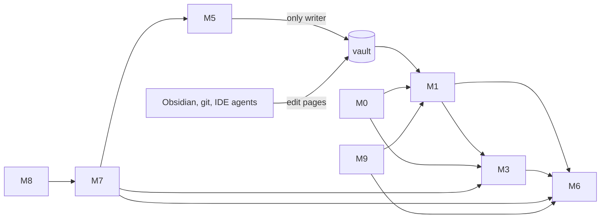

# Architecture

The common picture before detailed design (`MISSION.md` G16, R-22). Words follow `GLOSSARY.md`. Above every choice: for
users, "make the right way the easy way"; for builders, "as simple as possible but no simpler". **[OPEN: …]** marks a slot
for the package named.

## 1. Model, views and control

Model, view and control (MVC, in software architecture):

|Part|What it is|Relation to the model|
|---|---|---|
|**Model**|The ontology (`ontology/scat.ttl`, one source, R-13) plus a conformant vault: entries as Markdown in git.|Git is authoritative.|
|**Views**|The Obsidian layout (M5's index pages, M10's settings; WP16's design), fingerprint view, edge tables, layered view, traces.|Built from a conformant model; write no entry.|
|**Control**|Obsidian, git and GitHub, the CLI and REPL, the MCP server, IDE agents.|Act through an operation, or edit pages the tool then checks.|

1. **The knowledge graph is derived, never held**: rebuilt from the Markdown on every call.
2. **A view needs a conformant vault.** M6 refuses on errors in the pages it draws and is deterministic, so diffing a
   regeneration is a test. Stored output (index pages; chat-path view files in one folder, stamped with the commit) is
   written by M5; the loader ignores it.
3. **Only operations write through the tool** (R-4). Obsidian, git and IDE agents edit pages; the same check reads them.

## 2. Actors and authorities

|Actor|Authority|Modules|
|---|---|---|
|**Coder**|Interpretation: the account matches the notes and the coding is right; moves entries into and out of `done`.|None; owns the pages.|
|**Tool**|Conformance: (i) the knowledge graph matches the Markdown; (ii) it obeys the ontology.|(i) M4 finds where links and edges disagree, over M1's graph (a round-trip test covers M1). (ii) M0, M3. M5 writes.|
|**Assistant**|None. Drafts, drives calls.|Chat: M8; IDE: M7.|

No module in M0 to M6 can tell who is calling. The assistant's permitted and forbidden acts are written once, in a short
file under `contracts/` (WP18), cited by the MCP prompts, the IDE setup skill and the docs. Authority holds by
construction on the chat path (M8 never crosses `done`), and by that file and git review on the IDE path.

## 3. Modules

Owner: who decides what results mean. Every module returns data first (M2), text generated from it, and none raises
for a vault defect: it returns problems or a refusal. Unbuilt calls refuse.



|Module|Purpose, owner, status|Interface contract|Needed by|
|---|---|---|---|
|**M0 Ontology reader**|The one source of types, fields and ends. Owner: tool; content WP16. Exists (`tbox`, `models`).|In: `scat.ttl`. Out: types, fields, ends, statuses, read-only. Errors: an unreadable file stops the import (a build defect). R-16: result names come from here.|G1, R-1, R-13|
|**M1 Loader**|Read a vault into entries and the knowledge graph; the one place that knows how entries are stored. Owner: tool. Page reader exists, internal (`vault`); public loader, graph new (WP17).|In: a vault folder. Out: pages as written; the graph: nodes by layer, edges by type, narratives with fingerprints, links kept apart from edges. Errors: none for vault defects (represented, not judged); a missing folder is a refusal (new: today an empty vault). R-16: a versioned graph document.|G2, G12, R-16, R-17|
|**M2 Result and fix data**|The machine interface: one vocabulary for problems, refusals, effects and fixes, with its schema. Owner: tool. Exists (`fix`, `contract`, `ops/result`, `contracts/`).|In: what modules report. Out: documents with `schema_version`; fix kinds exact, options, slot, advisory, manual (a fix no edit can express); five edit actions. R-16: is it; adding a field keeps the version, removing or changing one bumps it.|R-2, R-8, R-16|
|**M3 Checks**|Job (ii) and the engine: rules on one entry (rules 1 and 2 of section 4), at three scopes (a page, a page and every page one link away, the vault). Owner: tool. Exists (`checks`); WP16 revises rules.|In: loader output, a scope, a page. Out: a report in catalogue order; each problem: rule id, severity, file, place, message, fix as data. Errors: none; M7 refuses a name not found or ambiguous (new: the checks raise today). Never writes; reads structure, not content (but the mention warning). R-16: the check document.|G2 to G4, R-1 to R-5|
|**M4 Mismatch**|Job (i): the rules that compare forms (rules 3 and 4, section 4), in M3's report. Owner: tool. Partly exists (link rules); rest new (WP16).|In: the graph with links and edges. Out: problems in M3's report, one per mismatch per anchor; severity by paired rule ids (a warning id, an error id); fixes that edit the right form. Errors: none. R-16: the problem shape.|G17, R-23, R-3|
|**M5 Operations**|Every write: stubs (narrative, node, pages links entail), set status, index pages, view files, record and remove an edge. Owner: tool. Exists: stubs, set status, index. New (WP16): record and remove edge (replacing pair stubs), the `done` refusal, problems left.|In: a vault folder and the subject. Out: created, changed, unchanged, refused, notes, and the problems it leaves, one link away. Errors: a refusal with fix data, nothing written; repeating gives "unchanged". Never writes a narrative's text. Set status to `done` grades the page as at `done`, one link away (rule 3, the edges it names), and refuses on an error. Only M7's set status crosses `done`, both ways; record and remove edge refuse when the edge, or a narrative they add or drop, is `done`, naming the coder's step. R-16: the operation document.|G3, G4, R-4, R-8, R-11|
|**M6 View generator**|Build each view once for every front end. Owner: maintainers; no authority. New (WP17).|In: the graph, M3's report, a view name, parameters (narratives, a node, a direction). Out: versioned, deterministic view data; renderings (CSV; drawings, an optional extra). Errors: refuses on errors in the pages it draws, returning those problems. R-16: view data.|G12, G14, R-17, R-20|
|**M7 Python API and CLI**|One call per operation, check, status and view; the CLI is those calls as text or `--json`. Owner: tool. Exists (`scat_kg`, `cli`).|In: arguments (page, scope, `root`). Out: the result; text is `str(result)`, `--json` is `to_dict()`. Exit 0 ok, 1 error or refusal, 2 bad line. R-16: passed through.|G4, R-8, R-9, R-19|
|**M8 MCP server**|The same calls for a chat with no terminal, plus prompts and skills for the coding loop. Owner: a front end, no authority. New (WP18).|In: a tool call for each M7 call but a move into or out of `done`. A call names no vault: the server holds one clone, fixed at setup, read afresh on each call; an edit elsewhere shows once git brings it. Out: M2 documents; view files through M5. Errors: refusals and problems are results. R-16: passed through. The transport is outside.|G14, R-16, R-20|
|**M9 Notebook**|Show the views to a coder at a desk. Owner: maintainers; no authority. New (WP17), in the template.|In: a vault folder. Out: the four views and three edge tables as CSV; on errors in the pages drawn, the problems and no drawing. No parser of its own.|G12, R-17|
|**M10 Template**|The vault to clone: skeleton, `scat.toml` (the cap), Obsidian settings, pinned tools, case study (example and fixture), M9, IDE setup skill. Owner: the coder the clone; maintainers the rest. Exists in its own repository; WP16 migrates it.|In: a clone and one setup command. Out: a vault passing the whole-vault check (R-6). R-16: none; the vault is the data.|G5, G6, G15, R-6|

The `done` rules change today's unchecked `set_status`; WP16 owns the change to `docs/coding.md`,
`tests/ops/test_ops_status.py` and the fix-harness tests. Done stays unfrozen: the coder sets `draft`, edits, then `done`.

## 4. Links and edges (G17)

**Four forms**, a closed list (R-23); other links have no graph meaning and are checked only as links.
**L**: a narrative's link to a node (the narrative refers to it, nothing more). **E**: an edge's entry.
**N**: the edge's references to its two nodes. **T**: the edge's references to its narratives. The coder writes L in the
account. M5 writes E, N and T; the coder may edit them in Obsidian, then runs the check.

**Four rules.** (1) *Ends*, M3: both ends exist, in the layers the type joins, one entry per pair. (2) *Names*, M3: an
edge names at least one narrative, and each exists. These are conformance. (3) *Fingerprint*, M4: every narrative an edge
names links both its nodes. (4) *Candidate*, M4: a narrative links both ends of an edge that does not name it. Rule 3 is
anchored on the narrative (a warning until it is `done`, then an error: R-23) and on the edge once that is `done` (an
error): one problem per mismatch per anchor.

|Pair|What disagrees|Detection|Fix (form edited)|Incremental case|
|---|---|---|---|---|
|**L–N**|An edge names n and ends at x; n does not link x.|Rule 3.|Link x in n: exact `replace-text` where the account names x, else manual (L); or drop n from the edge (T).|Depth first: edge first, link later; the write's result warns. Breadth first: nothing names n yet.|
|**L–T**|An edge names n, but n links neither end.|Rule 3.|Drop n from the edge (T), or link both ends (L).|Depth first: the edge names n before n is written; n's check warns until it links.|
|**L–E**|n links both ends of an edge and does not name it. Not a mismatch under G1.|Rule 4; severity **[OPEN: ACE]**.|Name n in the edge (T), or leave it.|Breadth first: edges recorded after linking; n's check lists candidates.|
|**E–N**|An end is missing, in the wrong layer, or two entries join one pair. Conformance.|Rule 1; missing end: R-1, an error at every status.|Stub the missing node (M5), or relink if renamed; retype; merge duplicates.|Recording stubs absent ends; only a hand edit leaves one missing, and it shows at once.|
|**E–T**|An edge names no narrative, or one absent or not a narrative. Conformance.|Rule 2: none named warns until the edge is `done`; an absent page is a dangling link (R-1).|Name a narrative, stubbed if absent (M5), or remove the edge.|Depth first: recording an edge stubs a narrative not yet written.|
|**N–T**|The edge is `done` but a narrative it names lacks a link.|Rule 3, error id, on the edge.|Rule 3's fixes, or the coder sets the edge to `draft` (M7).|M5 refuses `done` while this holds; a later edit to the narrative breaks it, shown on the edge.|

**Why no order of coding hides a mismatch.**
1. *Total and stateless.* M1 reads all four forms from the Markdown on every call; nothing stored goes stale.
2. *Graded at every status.* Rules 1 and 2 follow R-1; rule 3 warns on unfinished work (R-3), errs once `done`; no
   order of coding reaches an ungraded state. Rule 4 follows the ACE.
3. *Scopes.* A rule may read any page, so a page check reports every problem anchored on it; an edge and its narratives
   are one link apart both ways, so the edge's one-link-away check covers them; rule 4 on others shows on their own
   check or the vault scope.
4. *Writes report what they leave.*

A forgotten edge is graded by no rule (G1); the fingerprint view shows it. A generator test builds vaults in each order
(nodes first, edges first, one narrative at a time), injects every mismatch above, and asserts a report with a fix.

**Fragment** (the four forms drawn plainly; the layout is WP16's).
```
dry-july      scenario draft      links: allocation
sensor-pitch  architecture done   links: allocation, soil-sensor
holds(farmers, allocation)        names: dry-july, sensor-pitch
```
- *Case 1.* `sensor-pitch` names the edge but does not link `farmers`: an error on it (L–N). Rule 3 outranks the
  discouraged-link warning a group link in an architecture draws; the usual fix drops it from the edge.
- *Case 2.* An edge recorded first makes the result warn on `dry-july` until it links `farmers`.
- *Case 3.* Remove edge deletes E, N and T, keeping links; it is refused while `sensor-pitch` is `done`.
- *Case 4.* Deleting `allocation` by hand leaves dangling links and a missing end; `stub-links` restores it.

## 5. The coding loop and the journey

The loop: **interpreting** (notes and views, M6; doubt returns here), **authoring** (Obsidian; M5 stubs the page; an
assistant may draft), **coding** (the coder links nodes where the account names them; M5 records edges; M4 reports),
**reviewing** (page check, then one link away, M3 and M4; apply fixes; failure returns to coding; the coder confirms both
judgements), **done** (the coder sets it; M5 grades first).

No module writes a narrative's text; the coder applies fixes to it in Obsidian.

|Stage|Manual path|Chat path|
|---|---|---|
|J1, J3, J4, J6|The docs.|Same.|
|J2 Try|M10 setup; the loop in Obsidian, M7, M5.|None: J2 is manual.|
|J5 Set up|Private repository from M10; clone; setup; Obsidian.|Private repository from M10; terminal-free git; M8 on its clone. **[OPEN: RS3]**|
|J7 Capture|The inputs, outside the tool.|Notes uploaded to the chat.|
|J8 Code|The loop, in Obsidian and M7.|The loop, M8 for M7; narrative text reaches the vault by the coder's paste or download.|
|J9 Analyse|M9, or M7's view calls; the reading may send the loop round again.|M8 view calls (M6); M5 writes files.|
|J10 Hand over|Whole-vault check clean (M3, M4), `index` (M5), views, commit, push, tag.|Through M8, then terminal-free git.|

**Terminal-free git** (clone, commit, push, tag, keeping M8's clone current) belongs to the coder's tools (GitHub's web
interface, GitHub Desktop, an Obsidian git plugin), not M8.

## 6. What is left open

- **[OPEN: WP16] Edge as page or field.** Constraints: R-21; checked in Obsidian (G15); recording an edge writes no other
  entry; one seam reads the storage and builds edits on it, shared by M1, M4, M5.
- **[OPEN: WP16] Type slugs and the ontology's edge names.** Constraints: user-facing names follow the glossary; one source (R-13);
  a field rename bumps the schema.
- **[OPEN: WP16] Names and arguments of record-edge and remove-edge (R-8).** Constraints: REPL and CLI twins; arguments give
  two nodes and the narratives; effects stay inside M5's contract; recording on an existing pair adds its
  narratives; the result names an edge's narratives.
- **[OPEN: WP16] Where an edge records its narratives.** Constraint: one entry per pair.
- **[OPEN: WP16] How the one-link-away scope treats edges.** Constraint: an edge, its narratives and nodes are one link apart
  both ways, wherever it is stored (section 4, property 3).
- **[OPEN: WP17] The graph document's shape and each view's parameters.** Constraints: R-17; notebook and M8 return equal
  view data (R-20).
- **[OPEN: WP18] Tool, prompt and skill names; the assistant's file; the view folder.**
- **[OPEN: RS3] The chat route, and how terminal-free git is done.** RS3's notes: the chat is LibreChat, which reaches a
  remote MCP server from its own server over streamable HTTP; a tool on the coder's machine is not reachable; the route
  is not yet shown to work. M8's contract is unchanged either way.
- **[OPEN: ACE] Three calls, none decided here.** (a) Rule 4: A, nothing, candidates in the fingerprint view; B, a warning
  while draft, silent at `done`; C, a warning at `done` only. (b) The IDE path's residual authority risk. (c) The
  readout's guidance-versus-example gap as a WP16 test case.
