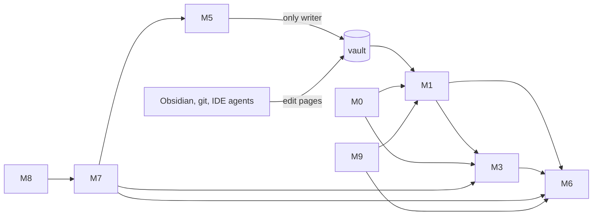

# Architecture

How SCAT is built, for people who build or change it. Words follow the [terms](reference/terms.md). Two aims run through
every choice: for users, make the right way the easy way; for builders, as simple as possible but no simpler.

## Words this page uses

The [terms](reference/terms.md) hold the organiser's words. These are the builders' words: the terms page leaves them out, and the contracts use them.

- **Element.** A node or an edge.
- **Entry.** One node, edge, narrative or relationship annotation as stored in the vault: a page, a table row or a body line.
- **The ontology.** The project's fixed definitions of the types and their rules, in `ontology/scat.ttl` (the TBox). The tool checks a vault against it.
- **Knowledge graph.** The nodes, edges and narratives the tool builds from a vault, with the contributor pages where the attribution mode allows them. Derived on every call, never held.
- **Layered graph.** The nodes and edges only, in their four layers: the knowledge graph without narratives, contributor pages and relationship annotations.
- **Model.** The ontology plus a conformant vault, the M of section 1. As a kind of material, the git repository that holds them. An assistant's language model is neither.
- **Inputs.** The field notes: the supplied material, outside the tool.
- **Analysis.** The reports derived from the model; also the step that reads the views.
- **Range vault.** A vault that rebuilds a published case with groups, not named people, to test the tools. It is not field data.
- **Norm.** Guidance to coders and assistants, the same for a person as for an LLM, carried in the docs and the skill files; the tool does not enforce it.
- **Skill.** A package of instructions that an assistant loads and follows; the assistant is still the actor and holds no authority.
- **Saved agent.** The chat's feature that keeps an assistant set up for a purpose, so a new chat starts from it.
- **Session key.** The key the coder pastes into the chat for one chat run so the chat reaches the tool; it is kept in the login keychain and deleted at Stop.

## 1. Model, views and control

Model, view and control (MVC):

|Part|What it is|Relation to the model|
|---|---|---|
|**Model**|The ontology (`ontology/scat.ttl`, one source) plus a conformant vault: entries as Markdown in git.|Git is authoritative.|
|**Views**|The Obsidian layout (M5's index Bases, M10's settings), fingerprint view, edge tables, layered view, traces.|Built from a conformant model; write no entry.|
|**Control**|Obsidian, git and GitHub, the CLI and REPL, the MCP server, IDE agents.|Act through an operation, or edit pages the tool then checks.|

1. **The knowledge graph is derived, never held**: rebuilt from the Markdown on every call.
2. **A view needs a conformant vault.** M6 refuses on errors in the pages it draws and is deterministic, so diffing a
   regeneration is a test. Stored output (index pages; chat-path view files in one folder, stamped with the commit) is
   written by M5; the loader ignores it.
3. **Only operations write through the tool.** Obsidian, git and IDE agents edit pages; the same check reads them.

## 2. Actors and authorities

|Actor|Authority|Modules|
|---|---|---|
|**Coder**|Interpretation: the account matches the notes and the coding is right; moves entries into and out of `done`.|None; owns the pages.|
|**Tool**|Conformance: (i) the knowledge graph matches the Markdown; (ii) it obeys the ontology.|(i) M4 finds where links and edges disagree, over M1's graph (a round-trip test covers M1). (ii) M0, M3. M5 writes.|
|**Assistant**|None. Drafts, drives calls.|Chat: M8; IDE: M7.|

No module in M0 to M6 can tell who is calling. The assistant's permitted and forbidden acts are written once, in a file under `contracts/`, cited by the MCP prompts, the IDE setup skill and the docs. Authority holds by
construction on the chat path (M8 never crosses `done`), and by that file and git review on the IDE path.

## 3. Modules

Owner: who decides what results mean. Every module returns data first (M2), text generated from it, and none raises
for a vault defect: it returns problems or a refusal.



|Module|Purpose and owner|Interface contract|
|---|---|---|
|**M0 Ontology reader**|The one source of types, fields and ends. Owner: tool (`tbox`, `models`).|In: `scat.ttl`. Out: types, fields, ends, statuses, read-only. Errors: an unreadable file stops the import (a build defect). Result names come from here.|
|**M1 Loader**|Read a vault into entries and the knowledge graph; the one place that knows how entries are stored. Owner: tool (`vault`, `graph`).|In: a vault folder. Out: pages as written; the graph: nodes by layer; one edge per (type, from, to), built from the rows of every narrative's "Edges told" table and naming those narratives; narratives with fingerprints, those that link a node page (coded); an uncoded narrative is left out of the graph and recorded as excluded; links kept apart from edges; contributor pages are in the knowledge graph (a narrative's `attributed_to` links resolve to them) and never in the layered graph: no node, edge, fingerprint or cap, and their links never code a narrative. Reads tables whitespace-tolerantly. Errors: none for vault defects (represented, not judged); a missing folder is a refusal. Out is a versioned graph document.|
|**M2 Result and fix data**|The machine interface: one vocabulary for problems, refusals, effects and fixes, with its schema. Owner: tool (`fix`, `contract`, `ops/result`, `contracts/`).|In: what modules report. Out: documents with `schema_version` (3); fix kinds exact, options, slot, advisory, manual (a fix no edit can express); five edit actions. Adding a field keeps the version; removing or changing one bumps it.|
|**M3 Checks**|Job (ii) and the engine: rules on one entry (rules 1 and 2 of section 4), at three scopes (a page, a page and every page one link away, the vault). Owner: tool (`checks`).|In: loader output, a scope, a page. Out: a report in catalogue order; each problem: rule id, severity, file, place, message, fix as data. Errors: none; M7 refuses a name not found or ambiguous. The one mode-dependent rule (the vault's attribution mode: whether a narrative must, may or must not name its contributors; the catalogue's mode rule section states it) and the contributor page type live in `checks/attribution.py`, with the type's fields in the TBox (M0); the mode is read first and the whole vault is graded against it. Never writes; reads structure, not content (but the mention warning). Out is the check document.|
|**M4 Mismatch**|Job (i): the rules that compare forms (rules 3 and 4, section 4), in M3's report. Owner: tool.|In: the graph with links and edges. Out: problems in M3's report, one per mismatch; severity by paired rule ids (a warning id, an error id); fixes that edit the right form. Errors: none.|
|**M5 Operations**|Every write: stubs (narrative, node, pages links entail), set status, index pages, view files, record and remove an edge, merge two node pages, plan a split. Owner: tool (`ops`).|In: a vault folder and the subject. Out: created, changed, unchanged, refused, notes, and the problems it leaves, one link away. Errors: a refusal with fix data, nothing written; repeating gives "unchanged". Never writes a narrative's text, except the links `merge` rewrites. Set status to `done` grades the page as it would stand at `done`, one link away, and refuses on an error. Only M7's set status crosses `done`, both ways; record and remove edge add or delete a row, leave links, and refuse when a narrative they would change is `done`, naming the coder's step (set it to `draft`). `merge a b` folds node page a into node page b of one type: it rewrites the links to a in the bodies of narratives and node pages (never frontmatter, code or a contributor page), appends a's body to b, removes a and writes the index pages, after trying the whole result in a temporary copy (the check shows no new error, the graph equals the old one with a renamed b); it refuses, writing nothing, on a cross-type pair, a contributor page, a contributor page that links a, or a duplicate row. `--plan` writes nothing. `split-plan a` lists what the coder must re-link and writes nothing. Out is the operation document.|
|**M6 View generator**|Build each view once for every front end. Owner: maintainers; no authority.|In: the graph, M3's report, a view name, parameters (narratives, a node, a direction). Out: versioned, deterministic view data; renderings (CSV; drawings, an optional extra). Errors: refuses on errors in the pages it draws, returning those problems. The attribution view (`scat attribution`) lists narratives by contributor; it is a view of the knowledge graph, not of the layered graph, so no contributor page enters a fingerprint, edge table, layered view or trace, and it refuses where the mode is disallowed. The evidence view (`scat evidence`) gives, for one node page, the narratives that link it with the paragraph around each link, its edges and its adjacent nodes; it is a view of the four layers and reads no `attributed_to` and no contributor page. The copy-share view (`scat copy-share`) gives, for each node page, the share of its five-word runs found word for word in a coded narrative and the narratives they come from; it reads no `attributed_to` and no contributor page. The review view (`scat review`) proposes where to look: pairs of node pages of one type that may be one node, by shared adjacent nodes, description words or a twin row, never by name, and pages whose accounts tell them to different other ends; it reads no `attributed_to` and no contributor page.|
|**M7 Python API and CLI**|One call per operation, check, status and view; the CLI is those calls as text or `--json`. Owner: tool (`scat_tools`, `cli`).|In: arguments (page, scope, `root`). Out: the result; text is `str(result)`, `--json` is `to_dict()`. Exit 0 ok, 1 error or refusal, 2 bad line.|
|**M8 MCP server**|The same calls for a chat with no terminal, plus prompts and a resource for the coding loop. Owner: a front end, no authority.|In: a tool call for each M7 call but a move into or out of `done` and the applying of a merge (it shows the merge plan and the split plan). A call names no vault: the server holds one clone, fixed at setup, read afresh on each call; an edit elsewhere shows once git brings it. Out: M2 documents; view files through M5. Errors: refusals and problems are results. The transport is outside.|
|**M9 Notebook**|Show the views to a coder at a desk. Owner: maintainers; no authority. Lives in the template.|In: a vault folder. Out: the four views and three edge tables as CSV; on errors in the pages drawn, the problems and no drawing. No parser of its own.|
|**M10 Template**|The vault to clone: skeleton, `scat.toml` (the attribution mode and the cap), Obsidian settings, pinned tools, case study (example and fixture), M9, IDE setup skill. Owner: the coder for their clone, maintainers for the rest. Lives in its own repository.|In: a clone and one setup command. Out: a vault passing the whole-vault check. The vault is the data.|

The coder sets `done` through M7's set status, which grades first. Done stays unfrozen: the coder sets `draft`, edits, then `done`.

## 4. Links and edges

**Four forms**, a closed list; other links have no graph meaning and are checked only as links.
**L**: a link in a narrative's account or table. A row's end is a link. **E**: an edge, one
per (type, from, to), never stored: built from rows. **N**: a row's two ends. **T**: the row itself, which names its
narrative. The coder writes L and rows; M5 writes rows; Obsidian's table editor may re-pad them. The edge's type follows
its layers: `holds` (group, concern), `is addressed by` (concern, affordance), `is provided by` (affordance,
technology); slugs `holds`, `addressed-by`, `provided-by`. An edge is `done` when every narrative telling it is.

**Four rules.** (1) *Ends*, M3: a row's type is known and both ends are nodes in the layers it joins, in its direction.
(2) *Told*, M3: no narrative has two rows for one pair. These are conformance. (3) *Fingerprint*, M4: every row end is a
link (`[[page]]`, not plain text). (4) *Candidate*, M4: a narrative links both ends of an edge it has no row for. Rules 1 to 3 are
anchored on the narrative: each a warning until it is `done`, then an error. One problem per mismatch.

|Pair|What disagrees|Detection|Fix (form edited)|Incremental case|
|---|---|---|---|---|
|**L–N**|A row's end is plain text, not a link.|Rule 3.|Replace the text with the link (L); or delete the row (T).|Only a hand edit leaves one.|
|**L–E**|n links both ends of an edge and has no row for it. Not a mismatch: the account may only mention both.|Rule 4: no message; a candidate in the fingerprint view when asked for.|Add a row to n (T), or leave it.|Breadth first: rows recorded after linking.|
|**E–N**|An end is not a node, is in the wrong layer or direction, or the type is unknown. Conformance.|Rule 1; an end that is no page is graded likewise.|`stub-links` makes the missing node (M5); relink if renamed, retype or turn the row.|Recording stubs absent ends; only a hand edit leaves one.|
|**E–T**|A narrative tells a pair twice. Conformance.|Rule 2.|Merge the rows.|Recording an existing pair is "unchanged".|

**Why no order of coding hides a mismatch.**
1. *Total and stateless.* M1 reads all four forms from the Markdown on every call; nothing stored goes stale.
2. *Graded at every status.* Rules 1 to 3 warn on unfinished work, err once `done`; no
   order of coding reaches an ungraded state. Rule 4 gives no message. (A link in an account to no page is an error at every status.)
3. *Scopes.* An edge lives in its narratives' pages, so a page check reports every problem on its rows, and the
   one-link-away check of a node covers the narratives that tell its edges; rule 4 on others shows on their own check
   or the vault scope.
4. *Writes leave no mismatch and say what they did.* `record-edge` links both ends, stubs an absent node and notes the row
   it added; `stub-links` makes the node pages that row ends link and the vault lacks.

A forgotten edge is graded by no rule; the fingerprint view shows it. A generator test builds vaults in each order
(nodes first, rows first, one narrative at a time), injects every mismatch above, and asserts a report with a fix.

**Fragment** (the forms drawn).
```
dry-july      scenario draft      links: allocation
sensor-pitch  architecture done   links: allocation, soil-sensor
  Edges told: holds | farmers | allocation
```
- *Case 1.* A hand-written row in `sensor-pitch` has `farmers` as plain text: an error on it (L–N); the fix offered is
  the link, or deleting the row.
- *Case 2.* `record-edge holds farmers allocation --told-by dry-july` adds the row with both ends linked, stubbing
  `allocation` if absent: no problem. `dry-july`'s account need not link `farmers` (rule 4 stays silent).
- *Case 3.* Remove edge deletes its rows, keeping links; it is refused while `sensor-pitch` is `done`.
- *Case 4.* Deleting `allocation` by hand leaves dangling links and a row end that is no page; `stub-links` restores it.

## 5. The coding loop and the journey

The loop: **interpreting** (notes and views, M6; doubt returns here), **authoring** (Obsidian; M5 stubs the page; an
assistant may draft), **coding** (the coder links nodes where the account names them; M5 records edges; M4 reports),
**reviewing** (page check, then one link away, M3 and M4; apply fixes; failure returns to coding; the coder confirms both
judgements), **done** (the coder sets it; M5 grades first).

No module writes a narrative's text; the coder applies fixes to it in Obsidian.

|Step (as in [the flow](flow.md))|Manual path|Chat path|
|---|---|---|
|Discover, Decide, Set terms, Plan|The docs.|Same.|
|Try|M10 setup; the loop in Obsidian, M7, M5.|None: trying alone is manual.|
|Set up|Private repository from M10; clone; setup; Obsidian.|Private repository from M10; terminal-free git; M8 on its clone.|
|Capture|The inputs, outside the tool.|Notes uploaded to the chat.|
|Code|The loop, in Obsidian and M7.|The loop, M8 for M7; narrative text reaches the vault by the coder's paste or download.|
|Analyse|M9, or M7's view calls; the reading may send the loop round again.|M8 view calls (M6); M5 writes files.|
|Hand over|Whole-vault check clean (M3, M4), `index` (M5), views, commit, push, tag.|Through M8, then terminal-free git.|

**Terminal-free git** (clone, commit, push, tag, keeping M8's clone current) belongs to the coder's tools (GitHub's web
interface, GitHub Desktop, an Obsidian git plugin), not M8.

## 6. Design choices

- **The edge row.** A narrative tells an edge in one row of its "Edges told" table (`from | type | to | note`, both ends
  links), the first table under that heading, at any level. The graph holds one edge per
  (type, from, to) naming every narrative with a row for it; its status is derived, with no edge sign-off. Page types: `group`, `concern`, `affordance`,
  `technology`, `narrative` (`kind` scenario or architecture; `timeframe` stays), `contributor`, `index`. Operations:
  `record_edge(type, from_, to, told_by, note="")` and `remove_edge(from_, to, told_by=None)`, with the CLI commands
  `scat record-edge` and `scat remove-edge`; recording adds a row only where none exists. A relationship annotation is
  a body line with a link, with no meaning to the tool: not an edge, and in no view. Bases need Obsidian 1.9 or later.
- **The view document.** Kind `view`; `operation` is `fingerprint`, `edges`, `layered` or `trace`, each a `scat`
  command with a REPL twin. Nodes are `{name, type, status}`; an edge names every narrative that tells it; the
  fingerprint adds rule-4 candidates only when asked for (`candidates`; default off). A view refuses, as an operation
  with `problems`, on an error in a page it draws, and on a skipped row in a narrative it draws, naming the row; a
  whole-vault view also refuses on a page whose frontmatter cannot be read, naming the file and why. A duplicate node
  name behind a row end is named with both files. `export-edges --out DIR` is the only writer. Shape:
  `machine-interface.schema.json`.
- **Coded and excluded.** A narrative that links no node page anywhere in its body is uncoded: the graph and every view
  leave it out, `check` reports it (SCAT-UNCODED, a warning) and each view that draws every narrative lists it as
  `excluded` with how to include it. A link to a node page in the account codes a narrative and puts the node in its
  fingerprint, with no edge. The view document carries `excluded`; a new field, so the version stays.
- **The chat route.** M8 runs on the coder's machine, behind a tunnel with an API key; the chat reaches it there. M8's
  contract does not depend on the tunnel.
- **Rule 4 and the IDE path.** Rule 4 gives no message, because whether an account tells an edge is content; the
  fingerprint view lists candidates when asked for. On the IDE path nothing refuses `done`: authority rests on the
  assistant's file and on git review, and the docs say so.
