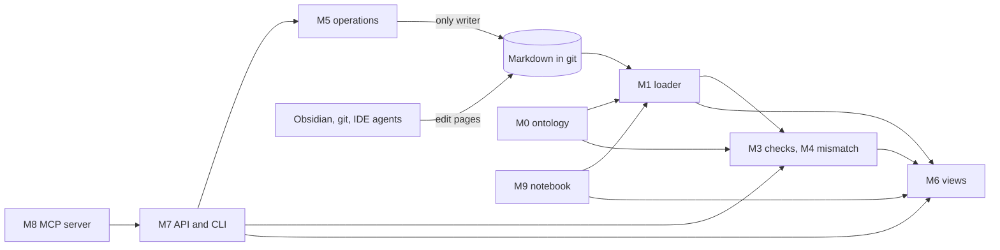

# Architecture

The common picture before detailed design (`MISSION.md` G16, R-22). Words follow `GLOSSARY.md`. Above every choice: for
users, "make the right way the easy way"; for builders, "as simple as possible but no simpler". **[OPEN: …]** marks a slot
left to the package named.

## 1. Model, views and control

Model, view and control (MVC, in software architecture):

|Part|What it is|Relation to the model|
|---|---|---|
|**Model**|The ontology (`ontology/scat.ttl`, one source, R-13) plus a conformant vault: entries as Markdown in git.|The git repository is authoritative.|
|**Views**|The Obsidian layout, fingerprint view, edge tables, layered view, traces.|Built from a conformant model; write nothing back into an entry.|
|**Control**|Obsidian, git and GitHub, the CLI and REPL, the MCP server, IDE agents.|Act through an operation, or edit pages the tool then checks.|

1. **The knowledge graph is derived, never held.** The loader rebuilds it from the Markdown on every call, so it cannot
   drift from the pages.
2. **A view needs a conformant vault.** The view generator runs the checks and refuses on an error. Views are
   deterministic, so diffing a regeneration is a test. Index pages are the one stored view: an operation writes
   them, they hold no entry, and a check flags a stale one.
3. **Only operations write entries.** Obsidian, git and IDE agents edit pages; the CLI, REPL and MCP call operations
   (R-4). Either way the same check reads the same Markdown.

## 2. Actors and authorities

|Actor|Authority|Modules|
|---|---|---|
|**Coder**|Interpretation: the account matches the field notes and the coding is right; sets `done`. Works in Obsidian.|None; owns the pages.|
|**Tool**|Conformance: (i) the knowledge graph matches the Markdown; (ii) it obeys the ontology.|(i) M1 builds the graph from pages alone; M4 finds where links and edges disagree. (ii) M0, M3. M5 writes.|
|**Assistant**|None. Drafts and drives calls.|Chat through M8; IDE agents through M7.|

No module in M0 to M6 can tell who is calling, so the same pages give the same verdict for coder or assistant. The
assistant's permitted and forbidden acts are written once, in one short file under `contracts/` (WP18), which the MCP
prompts, the IDE setup skill and the docs cite. M8 offers no way to set `done`; IDE agents can run the CLI, so for them
the guard is that file and M5's refusal.

## 3. Modules

Owner: who decides what results mean. Every module returns data first (M2), text generated from it, and none raises
for a defect in a vault: it returns problems or a refusal. A call not yet built refuses; it never passes silently.



|Module|Purpose, owner, status|Interface contract|Needed by|
|---|---|---|---|
|**M0 Ontology reader**|The one source of types, fields and ends. Owner: tool; content WP16. Exists (`tbox`, `models`).|In: `scat.ttl`. Out: types, fields, ends, statuses, read-only. Errors: an unreadable file stops the import (a build defect). R-16: names in results come from here.|G1, R-1, R-13|
|**M1 Loader**|Read a vault into entries and the knowledge graph; the one place that knows how entries are stored. Owner: tool (job i). Page reader exists, internal (`vault`); public loader and graph new (WP17).|In: a vault folder. Out: pages with fields and links as written; the graph: nodes by layer, edges by type, narratives with fingerprints, links apart from edges. Errors: none for vault defects (unresolved parts are represented, not judged); a missing folder is a refusal. R-16: a versioned graph document.|G2, G12, R-16, R-17|
|**M2 Result and fix data**|The machine interface: one vocabulary for problems, refusals, effects and fixes, with its schema. Owner: tool. Exists (`fix`, `contract`, `ops/result`, `contracts/machine-interface.*`).|In: what modules report. Out: documents with `schema_version`; fix kinds exact, options, slot, advisory, manual; edit actions set-field, delete-field, replace-text, rename-file, delete-file. R-16: is it; adding a field keeps the version, removing or changing one bumps it.|R-2, R-8, R-16|
|**M3 Checks**|Job (ii) and the engine: rules on one entry, at three scopes (a page, a page and every page one link away, the vault). Owner: tool. Exists (`checks`); WP16 revises rules.|In: loader output, a scope, a page name or path. Out: a report in catalogue order; each problem: rule id, severity, file, place, message, fix as data. Errors: a name not found or ambiguous is a refusal. Never writes; reads structure, not content (R-1); R-5 budgets. R-16: the check document.|G2 to G4, R-1 to R-5|
|**M4 Mismatch**|Job (i): every rule that compares two forms (section 4), plugged into M3's report. Owner: tool. Partly exists (link rules); rest new (WP16).|In: the graph with links and edges. Out: problems in M3's report, one per mismatch, severity by R-23, each with fixes that edit the right form. Errors: none. R-16: the problem shape; an added field is WP16's.|G17, R-23, R-3|
|**M5 Operations**|Every write: stubs (a narrative, a node, pages links entail), set status, index pages, record and remove an edge. Owner: tool. Exists except the edge two (new, WP16; they replace pair stubs).|In: a vault folder and the subject. Out: created, changed, unchanged, refused, notes, and the problems it leaves, checked one link away. Errors: a refusal with fix data, nothing written; repeating gives "unchanged". Never writes a narrative's text; never changes an entry that is `done` (the refusal names the coder's step); refuses `done` while the page has an error. R-16: the operation document.|G3, G4, R-4, R-8, R-11|
|**M6 View generator**|Build each view once for every front end. Owner: maintainers; no authority. New (WP17).|In: the graph, a view name, parameters (narratives, a node, a direction). Out: versioned, deterministic view data; renderings (CSV; drawings, via an optional extra). Errors: refuses on an error in the vault, returning the check's problems. R-16: view data.|G12, G14, R-17, R-20|
|**M7 Python API and CLI**|One call per operation, check, status and view; the CLI is those calls as text or `--json`. Owner: tool. Exists (`scat_kg`, `cli`).|In: arguments (page, scope, `root`). Out: the result; text is `str(result)`, `--json` is `to_dict()`. Exit 0 ok, 1 error or refusal, 2 unreadable line. R-16: passed through.|G4, R-8, R-9, R-19|
|**M8 MCP server**|The same calls for a chat with no terminal, plus prompts and skills for the coding loop. Owner: a front end, no authority. New (WP18).|In: a tool call for each M7 call but setting `done`. Out: M2 documents unchanged; view files go where the caller names, never over an entry. Errors: refusals and problems are results. Stateless: each call reads the vault afresh. R-16: passed through. The transport is outside the contract.|G14, R-16, R-20|
|**M9 Notebook**|Show the views to a coder at a desk. Owner: maintainers; no authority. New (WP17), in the template.|In: a vault folder. Out: the four views and three edge tables as CSV. On an error in the vault it shows the problems and draws nothing. No parser of its own: it reads M1 and M6 data.|G12, R-17|
|**M10 Template**|The vault to clone: skeleton, `scat.toml` (the cap), Obsidian settings, pinned tools, case study (example and fixture), M9, IDE setup skill. Owner: the coder owns the clone; maintainers the skeleton and pin. Exists in its own repository; WP16 migrates it.|In: a clone and one setup command. Out: a vault on which the whole-vault check passes (R-6). R-16: none; the vault is the data.|G5, G6, G15, R-6|

## 4. Links and edges (G17)

**Four forms**, a closed list (R-23); any other link has no graph meaning and is checked only as a link.
**L**: a narrative's link to a node (the narrative refers to it, nothing more). **E**: an edge's entry.
**N**: the edge's references to its two nodes. **T**: the edge's references to its narratives. The coder writes L in the
account. M5 writes E, N and T, so structure is never hand-written; a hand edit is checked the same way.

**Four rules.** (1) *Ends*: both ends exist, in the layers the type joins, one entry per pair. (2) *Names*: an edge
names at least one narrative, and each exists. (3) *Fingerprint*: every narrative an edge names links both its nodes.
(4) *Candidate*: a narrative links both ends of an edge that does not name it. **A mismatch is anchored on the narrative
when one is involved**, so severity follows its status: a warning until `done`, then an error (R-23). Others sit on the edge. An edge cannot be `done` while a narrative it names lacks a link.

|Pair|What disagrees|Detection|Fix (form edited)|Incremental case|
|---|---|---|---|---|
|**L–N**|An edge names n and ends at x; n does not link x.|Rule 3.|Link x in n: exact `replace-text` where the account names it, else a slot (L).|Depth first: record the edge, link later; the write's result carries the warning. Breadth first: no edge names n yet, nothing disagrees.|
|**L–T**|An edge names n, but n links neither end.|Rule 3: one problem, two fixes.|Drop n from the edge (T), or link both ends (L).|A narrative named by mistake: n's check shows it.|
|**L–E**|n links both ends of an edge and does not name it.|Rule 4: a warning on `done` narratives only; a link is never an edge (G1).|Name n in the edge (T), or leave it as meant.|Breadth first: edges recorded after linking; the warning speaks at `done`.|
|**E–N**|An end is missing, in the wrong layer, or two entries join one pair.|Rule 1: a missing end is M3's (R-1, error at every status); layer and pair are M4's.|Stub the missing node (M5); swap or retype; merge duplicates, uniting narratives (E, N).|Recording an edge stubs absent ends; a missing end comes only from a hand edit, and shows at once.|
|**E–T**|An edge names no narrative, or one that is absent or not a narrative.|Rule 2, on the edge: none named is a warning until the edge is `done`; an absent page is a dangling link (R-1).|Name a narrative, stubbed if absent (M5), or remove the edge.|Depth first: an edge recorded before its narrative exists stubs it.|
|**N–T**|The edge is `done` but a narrative it names lacks a link.|Rule 3 at the edge's status: an error, on the edge.|Rule 3's fixes, or set the edge to `draft`.|A narrative set `done` later cannot carry an unlinked edge unseen: the edge's check fails first.|

**Why no order of coding leaves a mismatch unseen.**
1. *Total and stateless.* M1 reads all four forms from the Markdown on every call; no stored index goes stale.
2. *Every state is graded.* Each rule fires at every status, a warning for unfinished work (R-3) and an error once
   `done`; no order of coding reaches a state no rule grades.
3. *Scopes.* A rule may read any page, so a page check reports every mismatch anchored on it. An edge and the narratives
   it names are one link apart in both directions, so the one-link-away check covers the rest; the vault scope sees all.
4. *Writes report what they leave.* Record, remove and stub-links return the problems they leave, so on the chat path
   the assistant and coder see them at once.

A generator test builds vaults in each order (nodes first, edges first, one narrative at a time), injects every mismatch
above, and asserts it is reported with a working fix (R-23).

**Fragment** (the four forms drawn plainly; the layout is WP16's).
```
dry-july      narrative draft   links: farmers, allocation
sensor-pitch  narrative done    links: allocation, soil-sensor
holds(farmers, allocation)      names: dry-july, sensor-pitch
```
- *Case 1.* `sensor-pitch` is done and names a `holds` edge but links no group: an error on it (L–N). An architecture
  linking a group is also discouraged, so the usual fix drops it from the edge (L–T).
- *Case 2.* Recorded first (depth first), the edge makes the result warn on `dry-july`; linking `farmers` clears it.
- *Case 3.* Removing the edge deletes E, N and T; the narratives keep their links, so nothing disagrees.
- *Case 4.* Deleting `allocation` by hand leaves dangling links and a missing end (E–N), all errors; `stub-links` fixes it.

## 5. The coding loop and the journey

|Step|Who acts, through what|Modules|
|---|---|---|
|Interpreting|The coder reads field notes and views. Doubt returns here.|M6|
|Authoring|The coder writes it in Obsidian; an assistant may draft.|M5 stubs the page|
|Coding|The coder links nodes where the account names them and records each edge naming the narrative.|M5, M4|
|Reviewing|Page check, then one link away; apply each fix; a failure returns to coding. The coder confirms both judgements.|M3, M4, M6|
|Done|The coder sets `done`.|M5 refuses while an error stands|

|Stage|Manual path|Chat path|
|---|---|---|
|J1, J3, J4, J6|The docs.|Same.|
|J2 Try|M10 setup; the loop in Obsidian, M7, M5.|Not used: J2 is manual.|
|J5 Set up|Private repository from M10; clone; setup; open in Obsidian.|Private repository from M10 on GitHub; M8 reached from the chat. **[OPEN: RS3]**|
|J7 Capture|The inputs, outside the tool.|The notes uploaded to the chat.|
|J8 Code|The loop, in Obsidian and M7.|The loop with M8 for M7; the coder edits in Obsidian; git carries edits.|
|J9 Analyse|M9 (M1, M6); the reading may send the loop round again.|M8 view calls (M6); views written into the repository.|
|J10 Hand over|Whole-vault check clean (M3, M4), `index` (M5), views, commit, push, tag (the coder's act).|The same through M8; the tag by GitHub.|

## 6. What is left open

- **[OPEN: WP16] Edge as page or field.** M1 hides the choice. Constraints: R-21 (no duplicated content, no page without content of its own); checked in Obsidian (G15).
- **[OPEN: WP16] Type slugs and the ontology's edge names.** Constraints: user-facing names follow the glossary; renaming a
  field bumps `schema_version`; one source (R-13).
- **[OPEN: WP16] Names and arguments of record-edge and remove-edge (R-8).** Constraints: REPL and CLI twins, same
  messages; arguments give two nodes and the narratives; effects stay inside M5's contract; the result names the
  narratives the edge named.
- **[OPEN: WP16] Where an edge records its narratives.** Constraints: M1 reads it; one entry per pair; each narrative named
  is checkable.
- **[OPEN: WP16] How the one-link-away scope treats edges.** Constraint: an edge, its narratives and its nodes are one link
  apart in both directions, wherever the edge is stored (section 4, property 3).
- **[OPEN: WP17] The graph document's shape and each view's parameters.** Constraints: R-17; the versioning rule; notebook and
  M8 return equal views (R-20).
- **[OPEN: WP18] Tool, prompt and skill names; the assistant's file; where chat-path views are written.**
- **[OPEN: RS3] The chat route.** RS3's notes: the chat is LibreChat, which reaches a remote MCP server from its own server
  over streamable HTTP; a tool on the coder's machine is not reachable; the route is not yet shown to work. M8's contract
  holds either way. RS3 also decides how a remote server sees the vault and how Obsidian edits reach it.
- **[OPEN: ACE] R-23 reading.** Rule 4 is taken as a warning on `done` narratives, never an error (G1), and it repeats when
  the omission was meant, since a waiver was set aside (review record, Q4). The ACE confirms.
