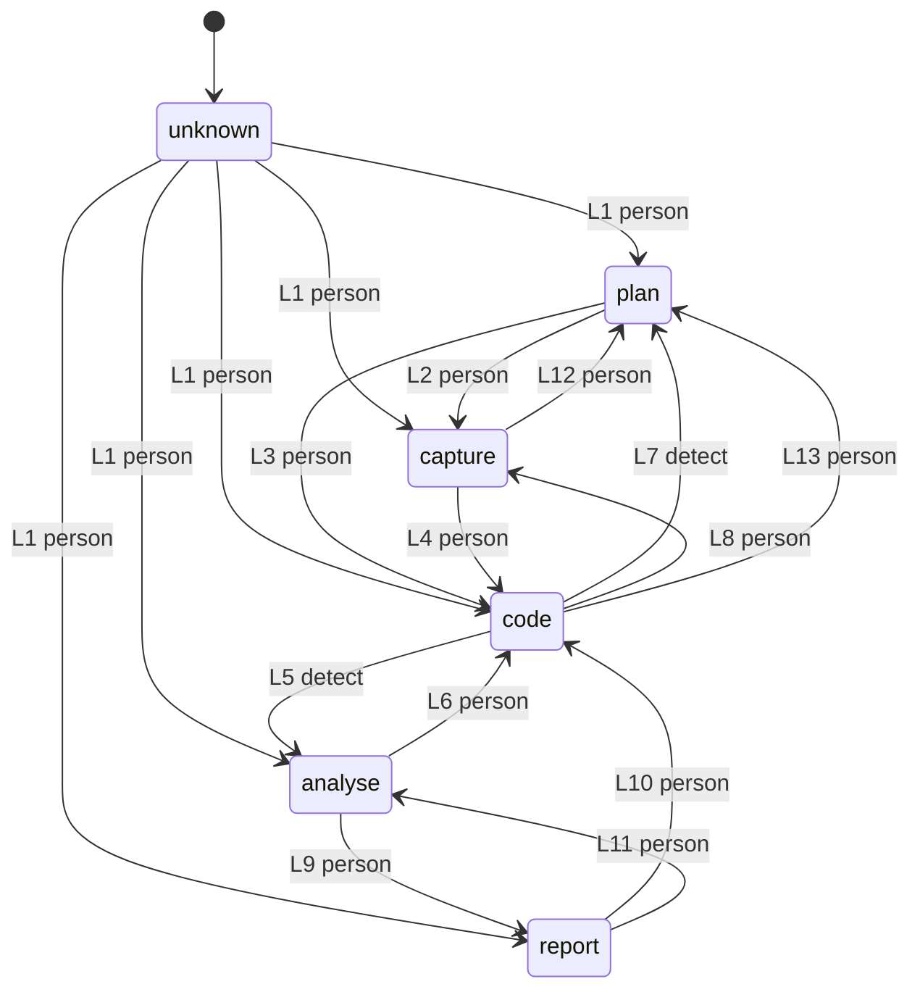

# The lifecycle: stages of a SCAT project

**Status.** Approved by the chief engineer (log D-186); the model is locked, and changes to it are amendments with
his approval. WP30 builds it into the server; WP31 writes the assistant's habits to it.

A SCAT project moves through **stages**: where the project is in its lifecycle. A stage names the work a person is
doing, so the server can offer the tools that work needs, refuse the rest, and say how to move on. A record's
**status** (`stub`, `draft`, `done`) is a different machine, on a different time scale: a page changes status many
times inside one stage (D-177). Stage never sets a status, and status never sets a stage; a stage's predicate may read
statuses.

## 1. The model

The smallest form that holds (WP29-G1):

| Element | What it is |
|---|---|
| **Stage** | A named state of the project. It lists the person's work in it; its **required inputs**, what must exist before the work makes sense (the stage's guide names them; the server checks them only through predicates); its **allowed outputs**, what may be produced or changed, each with what produces it and its **review loop** (who reviews it and how it is revised); and the **tools**, **prompts** and **skill sections** offered. |
| **Transition** | A move from one stage to another, forward or backward. It names its **trigger** (what prompts the move), its **predicate** and **who decides**. Only listed transitions can be made. |
| **Predicate** | A condition on a transition, of one of two kinds. **Detect**: the server evaluates it from the vault's present state through a named reader; when it holds, the server says the move is open. **Person**: only a person can say it holds; the server asks. (RS5 and WP29-G1 call these "detect" and "request".) A predicate is advice: no predicate moves the stage by itself, and a failed detect predicate does not stop a person's move. |
| **Who decides** | The role whose say-so makes the move: the organiser, the coder or the setup person. The assistant may propose a move; it never decides one. |
| **Unknown** | The stage before any stage is recorded. Every call except the stage tools gets the clarification answer (section 3). It is left only by a person naming a stage. |

Two rules hold across every stage (D-178):

- **Tools may be shared.** A tool belongs to every stage whose work uses it; stages are not a partition of the tools.
- **Every output has a review loop.** Nothing generated is assumed right on first pass. Each allowed output names who
  reviews it and how it is revised, so the person, not the assistant, is the author.

## 2. The instance for SCAT

Five stages, from the flow's steps (`docs/flow.md`) and the organiser's work (D-168): **plan** (steps 4 to 6: set
terms, set up, plan sessions), **capture** (step 7: facilitate and gather field notes), **code** (step 8, including the
views that inform it, D-178), **analyse** (step 9: read the views and write findings, with no change to narrative, node
or contributor pages) and **report** (step 10 and reporting findings). Steps 1 to 3 (discover, try, decide) come before
the project and are not stages. Step 4 often happens before the vault exists; it is still plan's work, and the vault
records the stage from step 5 on. The solo trial (steps 5, 2, 8) is plan then code, with no capture.

The data below is the instance. The consistency test (`tests/contracts/test_lifecycle.py`) and WP30 read it, so the
document and the code cannot drift. Tool and prompt names are the server's (19 tools after WP33, which folded the
drawing tools into `fingerprint`, `layered` and `trace`). "Writes" in a stage means changing narrative, node or
contributor pages; view files and exports are not.

```yaml lifecycle
stage_tools: [which_stage, set_stage]   # every stage and unknown; built by WP30

stages:
  plan:
    work: Set the terms of the elicitation, set up the vault, and plan the sessions and the stakeholder groups.
    required_inputs: [the organiser's decision to run an elicitation]
    allowed_outputs:
      - output: the documented answers to the nine choices (data, rights and consent)
        produced_by: the organiser, outside the tool
        review: the organiser checks them with whoever holds the rights before the first session
      - output: settings in scat.toml (attribution mode, cap)
        produced_by: the setup person, in the file
        review: the organiser checks them against the terms (D-159)
      - output: stub pages for planned stakeholder groups
        produced_by: stub
        review: the organiser reads each stub and renames, merges or removes it
    tools: [check, status, stub, attribution]
    tool_limits: {stub: group pages only}
    prompts: [explain-a-problem]
    skill_sections: [The words, The vault's mode, Where it holds, One step per reply, Norms]
  capture:
    work: Facilitate the sessions and gather field notes; nothing is coded yet.
    required_inputs: [the plan's sessions and groups]
    allowed_outputs:
      - output: field notes (plain text, outside the graph)
        produced_by: the note-taker, outside the tool
        review: the note-taker reads them back after each session and corrects them
    tools: [check, status]
    prompts: [explain-a-problem]
    skill_sections: [The words, Where it holds, One step per reply, Norms]
  code:
    work: Go round the coding loop for each narrative (interpreting, authoring, coding, reviewing), using the views to see what was coded and to find what is missing.
    required_inputs: [field notes (from capture, or the organiser's own), a set-up vault]
    allowed_outputs:
      - output: narrative pages (the account and its links)
        produced_by: the coder in Obsidian, or the assistant proposing text the coder accepts
        review: the coder reads each first version of the account against the field notes and revises it before any node or edge is taken from it
      - output: node pages and their descriptions
        produced_by: stub, stub_links, merge; the descriptions by the coder, or offered by the assistant
        review: the coder reads each page; an offered description is accepted, edited or declined by the coder
      - output: rows of a narrative's Edges told table
        produced_by: record_edge, remove_edge
        review: the coder reads each proposed row against the account; the tool records only rows the coder accepts
      - output: page status (stub, draft)
        produced_by: set_status (done is the coder's, in Obsidian)
        review: the coder sets done; the server refuses to set it
      - output: drawings and tables of the views
        produced_by: fingerprint, edge_table, layered, trace, evidence, review, attribution
        review: the coder reads them and decides what to revise
    tools: [check, status, set_status, stub, stub_links, record_edge, remove_edge, merge, split_plan, index, fingerprint, edge_table, layered, trace, evidence, copy_share, review, attribution]
    prompts: [code-a-narrative, explain-a-problem, review-before-done, draft-a-node-page, fill-in-node-pages, look-for-duplicates]
    skill_sections: [The words, What it does, What it does not do, How it hands over, The vault's mode, Where it holds, Edges told, Kind, One step per reply, Offering a description, Drafting a node page, Sweeping the stub node pages, Possible duplicates and merging, At the end of a session, Norms]
  analyse:
    work: Read the views of the whole knowledge graph and write findings from them; narrative, node and contributor pages are not changed.
    required_inputs: [a conformant vault]
    allowed_outputs:
      - output: drawings, tables and exports of the views
        produced_by: fingerprint, edge_table, layered, trace, evidence, copy_share, review, attribution, export_edges
        review: the organiser reads them; a doubt about the coding sends the work back to code
      - output: findings written from the views
        produced_by: the organiser, or the assistant proposing text in chat that the organiser accepts
        review: the organiser reads each finding against the views and the narratives it cites, and revises it
    tools: [check, status, fingerprint, edge_table, layered, trace, evidence, copy_share, review, attribution, export_edges]
    prompts: [explain-a-problem]
    skill_sections: [The words, What it does not do, How it hands over, The vault's mode, Where it holds, One step per reply, Norms]
  report:
    work: Hand the model over (a clean check, the index pages, a commit, the coder's statement and a tag) and report findings.
    required_inputs: [a conformant vault, the organiser's findings]
    allowed_outputs:
      - output: index pages
        produced_by: index
        review: the coder reads them before the commit
      - output: exported edges and figures for the report
        produced_by: export_edges, fingerprint, layered, trace
        review: the organiser checks each figure against its table before release
      - output: the hand-over statement and tag
        produced_by: the coder, in git
        review: the coder writes and signs them
    tools: [check, status, index, export_edges, fingerprint, edge_table, layered, trace, attribution]
    prompts: [explain-a-problem]
    skill_sections: [The words, The vault's mode, Where it holds, At the end of a session, Norms]

detects:   # each detect predicate, the reader that evaluates it, and whether that reader exists today
  every narrative is done and the whole-vault check has no errors: {reader: status and check (a count over status; WP30), exists: "partly"}
  the stakeholder-group count is at the cap: {reader: status and a scat.toml reader (WP30), exists: "no"}

transitions:
  - {id: L1, from: unknown, to: any, dir: start, trigger: the first call on a vault with no stage recorded, predicate: {kind: person, says: the person names the stage}, decides: coder}
  - {id: L2, from: plan, to: capture, dir: forward, trigger: the sessions are planned, predicate: {kind: person, says: the organiser says the sessions are planned}, decides: organiser}
  - {id: L3, from: plan, to: code, dir: forward, trigger: field notes already exist (solo trial, or notes from elsewhere), predicate: {kind: person, says: field notes are ready}, decides: organiser}
  - {id: L4, from: capture, to: code, dir: forward, trigger: field notes are gathered, predicate: {kind: person, says: field notes are ready}, decides: organiser}
  - {id: L5, from: code, to: analyse, dir: forward, trigger: the narratives are coded, predicate: {kind: detect, check: every narrative is done and the whole-vault check has no errors}, decides: coder}
  - {id: L6, from: analyse, to: code, dir: backward, trigger: reading the views shows something to revisit, predicate: {kind: person, says: the coder names what to revisit}, decides: coder}
  - {id: L7, from: code, to: plan, dir: backward, trigger: the cap refuses a new stakeholder group, predicate: {kind: detect, check: the stakeholder-group count is at the cap}, decides: setup person}
  - {id: L8, from: code, to: capture, dir: backward, trigger: more field notes are needed, predicate: {kind: person, says: the coder asks for more notes}, decides: organiser}
  - {id: L9, from: analyse, to: report, dir: forward, trigger: findings are ready, predicate: {kind: person, says: the organiser says the findings are ready}, decides: organiser}
  - {id: L10, from: report, to: code, dir: backward, trigger: work continues after a hand-over, predicate: {kind: person, says: the coder reopens the work}, decides: coder}
  - {id: L11, from: report, to: analyse, dir: backward, trigger: a finding needs another reading of the views, predicate: {kind: person, says: the organiser names the finding}, decides: organiser}
  - {id: L12, from: capture, to: plan, dir: backward, trigger: a session or the groups must be re-planned, predicate: {kind: person, says: the organiser re-plans}, decides: organiser}
  - {id: L13, from: code, to: plan, dir: backward, trigger: the attribution mode must change, predicate: {kind: person, says: the organiser changes the terms}, decides: organiser}
```



The diagram is generated from the data; the consistency test fails if they differ.

## 3. How stage travels and how the server answers

Chosen from RS5's options (`research/lifecycle/readout.md`, Q1 to Q12, and its client trials), and open to RS7's
findings on how a tool asks the person.

| Question | Choice | Evidence and reason |
|---|---|---|
| Unit of stage (Q1) | **One stage per vault**, the project's. | D-177: stage is where the project is. A session-held stage leaked across chats in inference.coop and was lost on restart in both clients (trials T9 and the shared-session finding). |
| Where it lives, how it travels (Q2, Q10) | **Stored in the vault**, in `lifecycle.toml` at the vault root (`stage`, `set_by`, `set_at`, and any pending request), read by the server on every request. Requests carry nothing. | Works the same in Claude and inference.coop and survives restarts; git keeps every move. No header is needed: Claude accepts only approved header names and inference.coop has no slot (T5). Nothing varies by connection, which the 2026-07-28 spec forbids (per RS5's reading and the ACE's re-read of its tools page). |
| Tool list (Q3) | **A stable list** of every tool; the stage is enforced by refusal. Each tool's description names its stages. | Claude never re-lists tools within a conversation (T2); refusals were relayed in full by both clients (T3). The same 2026-07-28 reading forbids a list that varies as a side effect of a call. |
| One server or a router (Q4) | **One server**, as deployed today. | The router added code and failure modes for no client-side gain under a stable list (RS5 Q4; T8). |
| Granularity (Q6) | **Five project stages**; the coding loop's activities and the assistant's modes live inside code, not as stages. | RS5 G:1 and G:2: steps 1 to 3 have no tool; the loop's activities share one tool set. |
| Who triggers a move (Q7) | Only a person, through `set_stage`; detect predicates only advise. | D-178: stages are the person's work; RS5 E:14 to 17 are the person's word. |
| Stage and status (Q9) | **Independent machines**; a predicate may count statuses. | D-177; RS5 E:9 (`done` is the coder's attestation). |
| Unknown stage (Q5) | Every call except the stage tools returns a **normal result** asking for the stage: it names the five stages, one line each, and says the person decides. Nothing is changed. | Both clients relayed it and asked the coder (T4). `isError` adds nothing: inference.coop drops it, Claude shows "Failed". |
| Out-of-stage call (Q5) | A **normal result**: the tool is not offered in this stage, the stages that offer it, and that a move is the person's say-so. Nothing is changed. | T3 in both clients. |
| Moving (Q11) | `set_stage(to, by)`. **`by`** names who made the call, as the person gave it; it is a signature slot written by the assistant, not proof of consent (D-179). The assistant calls `set_stage` only after the person says so. Without `by`, the move is recorded in `lifecycle.toml` as a pending request and nothing moves. A move with no listed transition is refused, naming the stage's exits. A failed detect predicate is reported and does not block. | D-179 defers stronger proof (C17). Elicitation, as tried, did not show the person a question (T7); RS7 studies how a tool should ask. |
| Prompts and resources (Q8) | Listed unscoped; each prompt's description names its stages. | Same reason as the tool list. |
| Shared tool names (Q12) | One schema per tool name, whatever the stage. | No prefixes; a tool means the same thing in every stage. |

**How each actor uses it.** `which_stage` returns the stage, who set it and when, the stage's work in one line, its
tools, and its exits: each transition out, its predicate, and for a detect predicate whether it holds now. A coder asks
the assistant "what stage are we in?" and gets that answer. The assistant reads the stage's guide (WP30 serves one per
stage, with its skill sections) and offers only the stage's work; a call outside it gets the refusal, which the
assistant relays. A reviewer reads `lifecycle.toml`'s history in git to see every move and who it names.

**Worked example (L7).** In code, `stub` refuses a new group because the vault holds its cap of groups. The refusal
says the cap is met, and `which_stage` shows L7 open ("the stakeholder-group count is at the cap"). The coder tells the
assistant to move to plan; the assistant calls `set_stage(to="plan", by="<the name the coder gave>")`. In plan the
setup person raises the cap in `scat.toml`, or the organiser decides to link an existing group instead, and the
organiser moves the project back to code.

**Risks for WP30.** `lifecycle.toml` is one file for the whole project, so every chat and every clone sees the same
stage; that is intended (D-177), but two people moving the stage in two clones can conflict in git, and `check` must
accept the file at the vault root.

## 4. Words

**Stage** and **transition** join the glossary and the terms page (WP29-G4), kept apart from **status**. The model's
other words (predicate, required input, allowed output, review loop) are defined in section 1; they are contract words
for builders, not organiser words, in line with the glossary cleanup (RS6, WP38).
