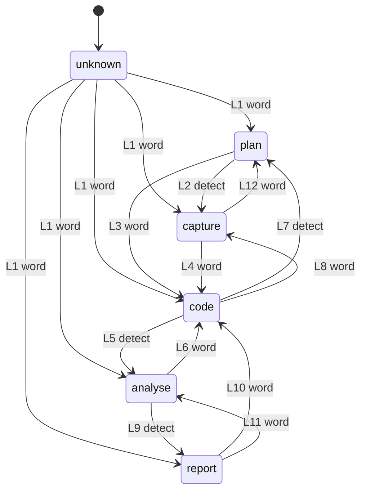

# The lifecycle: stages of a SCAT project

**Status.** DRAFT for the chief engineer's review (WP29). The model is locked only by his approval, recorded in
`decisions/log.md`. WP30 builds it into the server; WP31 writes the assistant's habits to it.

A SCAT project moves through **stages**: where the project is in its lifecycle. A stage names the work a person is
doing, so the server can offer the tools that work needs, refuse the rest, and say how to move on. A record's
**status** (`stub`, `draft`, `done`) is a different machine, on a different time scale: a page changes status many
times inside one stage (D-177). Stage never sets a status, and status never sets a stage; a stage's predicate may read
statuses.

## 1. The model

The smallest form that holds (WP29-G1):

| Element | What it is |
|---|---|
| **Stage** | A named state of the project. It lists the person's work in it, its **required inputs** (what must exist before the work makes sense), its **allowed outputs** (what may be produced or changed), the **tools**, **prompts** and **skill sections** offered, and, for each output, its **review loop**: who reviews it and how it is revised. |
| **Transition** | A move from one stage to another, forward or backward. It names its **trigger** (what prompts the move), its **predicate** and **who decides**. |
| **Predicate** | A condition on a transition. **Detect**: the server can evaluate it from the vault (a tool result); when it holds, the server says the move is open. **Word**: only a person can say it holds; the server asks. No predicate moves the stage by itself. |
| **Who decides** | The role whose word makes the move: the organiser, the coder or the setup person. The assistant may propose a move; it never decides one. |
| **Unknown** | The stage before any stage is recorded. Every call except the stage tools gets the clarification answer (section 3). It is left only by a person naming a stage. |

Two rules hold across every stage (D-178):

- **Tools may be shared.** A tool belongs to every stage whose work uses it; stages are not a partition of the tools.
- **Every output has a review loop.** Nothing generated is assumed right on first pass. Each allowed output names who
  reviews it and how it is revised, so the person, not the assistant, is the author.

## 2. The instance for SCAT

Five stages, from the flow's steps (`docs/flow.md`) and the organiser's work (D-168): **plan** (steps 4 to 6: set
terms, set up, plan sessions), **capture** (step 7: facilitate and gather field notes), **code** (step 8, including the
views that inform it, D-178), **analyse** (step 9: read the views and synthesise, without editing what was coded) and
**report** (step 10 and reporting findings). Steps 1 to 3 (discover, try, decide) come before a vault exists and are
not stages. The solo trial (steps 5, 2, 8) is plan then code, with no capture.

The data below is the instance. The consistency test (`tests/contracts/test_lifecycle.py`) and WP30 read it, so the
document and the code cannot drift. Tool and prompt names are the server's (19 tools after WP33, which folded the
drawing tools into `fingerprint`, `layered` and `trace`).

```yaml lifecycle
stages:
  plan:
    work: Set the terms of the elicitation, set up the vault, and plan the sessions and the stakeholder groups.
    required_inputs: [the organiser's decision to run an elicitation]
    allowed_outputs:
      - output: settings in scat.toml (attribution mode, cap)
        review: the setup person writes them; the organiser checks them against the terms (D-159)
      - output: stub pages for planned stakeholder groups
        review: the organiser reads each stub and renames, merges or removes it
    tools: [check, status, stub, attribution]
    prompts: [explain-a-problem]
    skill_sections: [The words, The vault's mode, Where it holds, One step per reply, Norms]
  capture:
    work: Facilitate the sessions and gather field notes; nothing is coded yet.
    required_inputs: [the plan's sessions and groups]
    allowed_outputs:
      - output: field notes (plain text, outside the graph)
        review: the note-taker reads them back after each session and corrects them
    tools: [check, status]
    prompts: [explain-a-problem]
    skill_sections: [The words, Where it holds, One step per reply, Norms]
  code:
    work: Go round the coding loop for each narrative (interpreting, authoring, coding, reviewing), using the views to see what was coded and to find what is missing.
    required_inputs: [field notes (from capture, or the organiser's own), a set-up vault]
    allowed_outputs:
      - output: narrative pages (the account and its links)
        review: the coder reads each draft account against the field notes and revises it before any node or edge is drawn from it
      - output: node pages and their descriptions
        review: the coder reads each page; an offered description is accepted, edited or declined by the coder
      - output: rows of a narrative's Edges told table
        review: the coder reads each proposed row against the account; the tool records only rows the coder accepts
      - output: page status (stub, draft)
        review: the coder sets done; the server refuses to set it
      - output: drawings and tables of the views
        review: the coder reads them and decides what to revise
    tools: [check, status, set_status, stub, stub_links, record_edge, remove_edge, merge, split_plan, index, fingerprint, edge_table, layered, trace, evidence, copy_share, review, attribution]
    prompts: [code-a-narrative, explain-a-problem, review-before-done, draft-a-node-page, fill-in-node-pages, look-for-duplicates]
    skill_sections: [The words, What it does, What it does not do, How it hands over, The vault's mode, Where it holds, Edges told, Kind, One step per reply, Offering a description, Drafting a node page, Sweeping the stub node pages, Possible duplicates and merging, At the end of a session, Norms]
  analyse:
    work: Read the views of the whole knowledge graph and synthesise findings; existing content is not edited.
    required_inputs: [a conformant vault]
    allowed_outputs:
      - output: drawings, tables and exports of the views
        review: the organiser reads them; a doubt about the coding sends the work back to code
      - output: synthesis (findings drafted from the views)
        review: the organiser reads each finding against the views and the narratives it cites, and revises it
    tools: [check, status, fingerprint, edge_table, layered, trace, evidence, copy_share, review, attribution, export_edges]
    prompts: [explain-a-problem]
    skill_sections: [The words, What it does not do, How it hands over, The vault's mode, Where it holds, One step per reply, Norms]
  report:
    work: Hand the model over (a clean check, the index pages, a commit, the coder's statement and a tag) and report findings.
    required_inputs: [a conformant vault, the organiser's findings]
    allowed_outputs:
      - output: index pages
        review: generated by the tool; the coder reads them before the commit
      - output: exported edges and figures for the report
        review: the organiser checks each figure against its table before release
      - output: the hand-over statement and tag
        review: the coder writes and signs them
    tools: [check, status, index, export_edges, attribution]
    prompts: [explain-a-problem]
    skill_sections: [The words, The vault's mode, Where it holds, At the end of a session, Norms]

transitions:
  - {id: L1, from: unknown, to: any, dir: start, trigger: the first call on a vault with no stage recorded, predicate: {kind: word, says: the person names the stage}, decides: coder}
  - {id: L2, from: plan, to: capture, dir: forward, trigger: the sessions are planned, predicate: {kind: detect, check: settings present (attribution mode and cap in scat.toml)}, decides: organiser}
  - {id: L3, from: plan, to: code, dir: forward, trigger: field notes already exist (solo trial, or notes from elsewhere), predicate: {kind: word, says: field notes are ready}, decides: organiser}
  - {id: L4, from: capture, to: code, dir: forward, trigger: field notes are gathered, predicate: {kind: word, says: field notes are ready}, decides: organiser}
  - {id: L5, from: code, to: analyse, dir: forward, trigger: the narratives are coded, predicate: {kind: detect, check: whole-vault check has no errors}, decides: coder}
  - {id: L6, from: analyse, to: code, dir: backward, trigger: reading the views shows something to revisit, predicate: {kind: word, says: the coder names what to revisit}, decides: coder}
  - {id: L7, from: code, to: plan, dir: backward, trigger: the cap refuses a new stakeholder group, or the attribution mode must change, predicate: {kind: detect, check: stub refused at the cap}, decides: setup person}
  - {id: L8, from: code, to: capture, dir: backward, trigger: more field notes are needed, predicate: {kind: word, says: the coder asks for more notes}, decides: organiser}
  - {id: L9, from: analyse, to: report, dir: forward, trigger: findings are ready, predicate: {kind: detect, check: whole-vault check has no errors}, decides: organiser}
  - {id: L10, from: report, to: code, dir: backward, trigger: work continues after a hand-over, predicate: {kind: word, says: the coder reopens the work}, decides: coder}
  - {id: L11, from: report, to: analyse, dir: backward, trigger: a finding needs another reading of the views, predicate: {kind: word, says: the organiser names the finding}, decides: organiser}
  - {id: L12, from: capture, to: plan, dir: backward, trigger: a session or the groups must be re-planned, predicate: {kind: word, says: the organiser re-plans}, decides: organiser}
```

The stage tools (`which_stage`, `set_stage`; WP30 builds them) belong to every stage and to unknown.



The diagram is generated from the data; the consistency test fails if they differ.

## 3. How stage travels and how the server answers

Chosen from RS5's options (`research/lifecycle/readout.md`, Q1 to Q12, and its client trials), and open to RS7's
findings on how a tool asks the person.

| Question | Choice | Evidence and reason |
|---|---|---|
| Unit of stage (Q1) | **One stage per vault**, the project's. | D-177: stage is where the project is. A session-held stage leaked across chats in inference.coop and was lost on restart in both clients (trials T9 and the shared-session finding). |
| Where it lives, how it travels (Q2, Q10) | **Stored in the vault**, in `lifecycle.toml` at the vault root (`stage`, `set_by`, `set_at`), read by the server on every request. Requests carry nothing. | Works the same in Claude and inference.coop and survives restarts. Git keeps every move. No header is needed: Claude accepts only approved header names and inference.coop has no slot (T5). It survives the 2026-07-28 spec, since nothing varies by connection. |
| Tool list (Q3, Q4) | **One server, a stable list** of every tool; the stage is enforced by refusal. Each tool's description names its stages. | Claude never re-lists tools within a conversation (T2); refusals were relayed in full by both clients (T3). A list that varies as a side effect of a call is not allowed by the 2026-07-28 spec. |
| Unknown stage (Q5) | Every call except the stage tools returns a **normal result** asking for the stage: it names the five stages, one line each, and says the person decides. Nothing is changed. | Both clients relayed it and asked the coder (T4). `isError` adds nothing: inference.coop drops it, Claude shows "Failed". |
| Out-of-stage call (Q5) | A **normal result**: the tool is not offered in this stage, the stages that offer it, and that a move is the person's word. Nothing is changed. | T3 in both clients. |
| Moving (Q7, Q11) | `set_stage` with the stage and **`by`**, naming who made the call (a signature slot, D-179). Without `by` it records a request and moves nothing. When a detect predicate holds, results say the move is open and name who decides. | D-179 defers stronger proof (C17). Elicitation, as tried, did not show the person a question (T7); RS7 studies how a tool should ask. |
| Prompts and resources (Q8) | Listed unscoped; each prompt's description names its stages. | Same reason as the tool list. |
| Shared tool names (Q12) | One schema per tool name, whatever the stage. | No prefixes; a tool means the same thing in every stage. |

## 4. Words

**Stage** and **transition** join the glossary (WP29-G4), kept apart from **status**.
