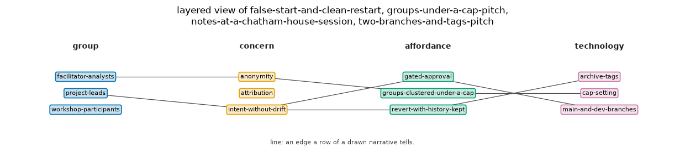

# Analysis

!!! tip "Your next step"
    In your vault, open `analysis.ipynb` and run all cells.

A **view** is a purposeful picture or table made from a conformant vault. The tool generates it. You interpret it: a view never says that a story, a group or an architecture is better.

## Before you trust a view

- `uv run scat check` passes. A view refuses on any error in the pages it draws, and says which.
- You have signed off the content (`done`). A view of `draft` pages shows the draft.

## The four views

**Fingerprint.** What does this narrative touch? It shows the nodes the narrative links and the edges it tells, in four columns, one for each layer. A dashed line is a link with no row. It does not mean the narrative is complete or wrong.

**Edge table.** Which edges of one type exist, and who tells them? Read it as a table, one row per edge. Exported as CSV, it feeds documents. It does not rank the edges.

**Layered view.** What is the big picture across several narratives? It joins their fingerprints in the four layers. Read across a column to see what is shared. It does not weigh a node by how many lines meet it.



**Trace.** What does this node reach? Following edges up goes toward groups, down toward technologies. It does not say how strongly a node depends on what it reaches.

## The notebook

The vault template holds `analysis.ipynb` at its root. It shows each view with a short paragraph and exports the three edge tables. Run all cells, then read.

The same views are one call away in the REPL and one command away on the CLI:

```python
import scat_kg

scat_kg.fingerprint("groups-under-a-cap-pitch")
scat_kg.edge_table("holds")
scat_kg.layered()
scat_kg.trace("anonymity", "up")
```

```bash
uv run scat fingerprint groups-under-a-cap-pitch
uv run scat edges holds
uv run scat layered
uv run scat trace anonymity --direction up
uv run scat export-edges --out edge-tables
```

A view's data is the same in the notebook, the CLI and later in chat.

## Drawings

Drawings need the extra `draw`: `pip install "scat-kg[draw]"`. In the vault template it is already installed.

```python
from scat_kg import draw

draw.fingerprint("groups-under-a-cap-pitch").save("fingerprint.png")
draw.layered().save("layered.png")
```

## Where next

- [Python API](reference/api.md) and [CLI](reference/cli.md): every call and command.
- [Terms](reference/terms.md): the words used here.
- [Coding](coding.md): back round the loop, where a view sends you.
