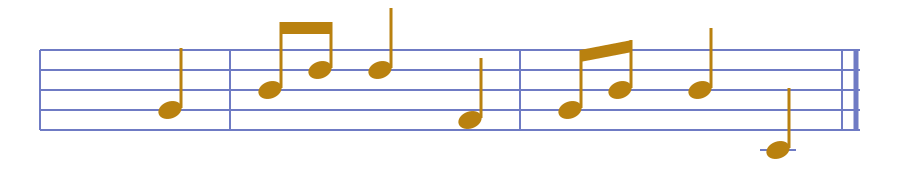
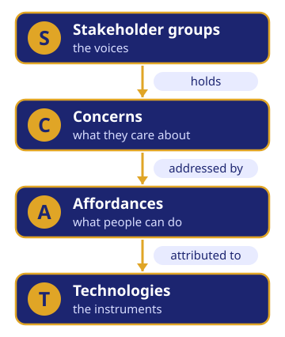

# SCAT

!!! tip "Your next step"
    Go to [Getting started](getting-started.md) and create your private repository.

A facilitated discussion goes in; a graph you can walk through comes out.

{ .hero }

## Before you start

You need nothing yet. You do not have to know the tools. This page tells you what SCAT is, why it has that name, and
what you will have at the end. The next page walks you through the first commands.

## What SCAT is

SCAT turns facilitated discussions into a structured set of notes you can read, follow and check.

You run workshops. Participants tell stories and propose designs. You take field notes. Afterwards you write each
account as a narrative page and code it, using four kinds of node:

- **S**takeholder groups: the groups of people the notes come from.
- **C**oncerns: what a group cares about.
- **A**ffordances: what a tool or arrangement lets someone do.
- **T**echnologies: the things that provide those affordances.

A narrative links the nodes it names, and tells the edges between them, the way the parts of a system fit together. A group
holds a concern. A concern is addressed by an affordance. An affordance is provided by a technology. Those edges are what
make the notes a graph you can walk through. An edge is one row in the table of a narrative that tells it, so there is
nothing to keep in step.

{ .bandstand }

Two kinds of session feed it, and they look at the same graph from opposite sides:

- **Scenarios are behavioural.** A scenario is a story of people doing things over time. Technology stays in the
  background. What shows is what it lets people do, its affordances. A scenario tells groups, concerns and
  affordances.
- **Architectures are structural.** An architecture is an assembly of parts into tools that offer affordances that
  address concerns. People are set aside, so a design does not presume who will use it. An architecture tells
  concerns, affordances and technologies.

The people in the four layers appear as **groups**, never as individuals. Each vault sets a cap on how many groups it
holds, and participants are clustered into groups that fit under it. Each vault also has one **attribution mode**,
`required`, `optional` or `disallowed`, which says whether a narrative names the people it is attributed to; in the first
two, those people have contributor pages outside the four layers. You choose the mode, and settle what the participation
terms agreed for the event allow, before the first session: see [Data, rights and consent](data-and-consent.md).

## Why it is called SCAT

SCAT is an acronym for the four things above. It is also named for scat singing, which is improvised: each singer takes what
the others offer and adds to it. Two habits from that carry through the whole method:

- **"Yes, and."** Whatever someone offers is written down as offered, then built on with a question that adds
  something. Nothing is turned away, and nothing is merged into someone else's line.
- **"From this perspective."** Each contribution is placed in the group it comes from and worded that way. Every
  contribution is taken up and set in its own perspective.

So when two groups want opposite things, SCAT does not settle it. It holds both. Concerns that pull against each other
are recorded as a relationship annotation, a plain line with a link, and the tools do not pick between them. Nobody has to be argued into agreement.

## What you end up with

A vault: a folder of linked pages that you open in Obsidian, kept in git. The tools check that every page fits the
structure, that every link goes somewhere and that every edge a narrative tells joins the nodes it should. You can click through from a group to its concerns, to the affordances
that address them, and to the technologies behind those. The git history is the record of how it got there.

## Who it is for

SCAT is for a facilitator-analyst: you are comfortable with technology but you are not a software developer, and you
work on a Mac. You plan and run workshops, take notes, and code them. You follow instructions step by step, and these
pages are written for that.

## The journey

Four stages, one page each. The first time through, take them in order, from the top.

| Stage | What you do | Page |
| --- | --- | --- |
| Plan | Decide which sessions collect scenarios and which collect architectures, who takes part, and how groups are formed. | [Planning](planning.md) |
| Capture | During the event, take field notes and write each account as a narrative. | [Facilitating scenarios](facilitate-scenarios.md) and [Facilitating architectures](facilitate-architectures.md) |
| Code | Afterwards, link the nodes each narrative names and record the edges it tells, fixing each problem from its message. | [Coding](coding.md) |
| Finish | Reach a clean check, commit, and explore the result in Obsidian. | [Coding](coding.md) |

Before the first stage you set up your own private vault: that is [Getting started](getting-started.md). To try SCAT alone first, on your own notes and in one sitting, follow [the solo trial](getting-started.md#the-solo-trial): set up, code one narrative, see its fingerprint and set it `done`. When you
need the exact form of a command, the reference has it: the [Python API](reference/api.md) and the
[CLI](reference/cli.md).

This documentation lives at <https://dynamicalsystemsgroup.github.io/scat-kg-tools/>.

## Where next

Take it from the top:

- [The flow](flow.md): the whole journey, step by step.
- [Getting started](getting-started.md): create your private repository and run your first check.
- [The solo trial](getting-started.md#the-solo-trial): try it alone on your own notes, in one sitting.
- [Coding paths](coding-paths.md): code by hand, with a chat, in an IDE, or with a local model.
- [Terms](reference/terms.md): how the pieces relate, in one place.
