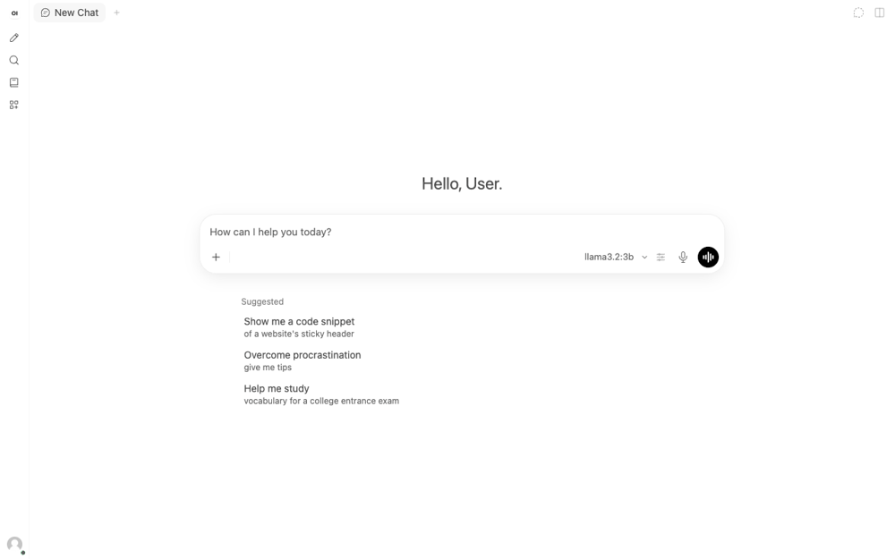
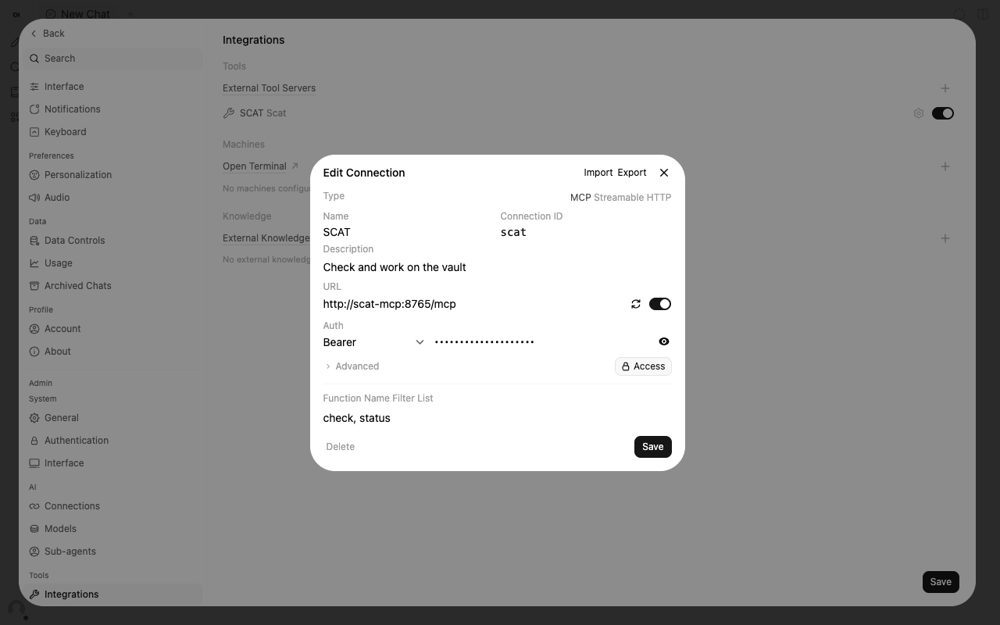
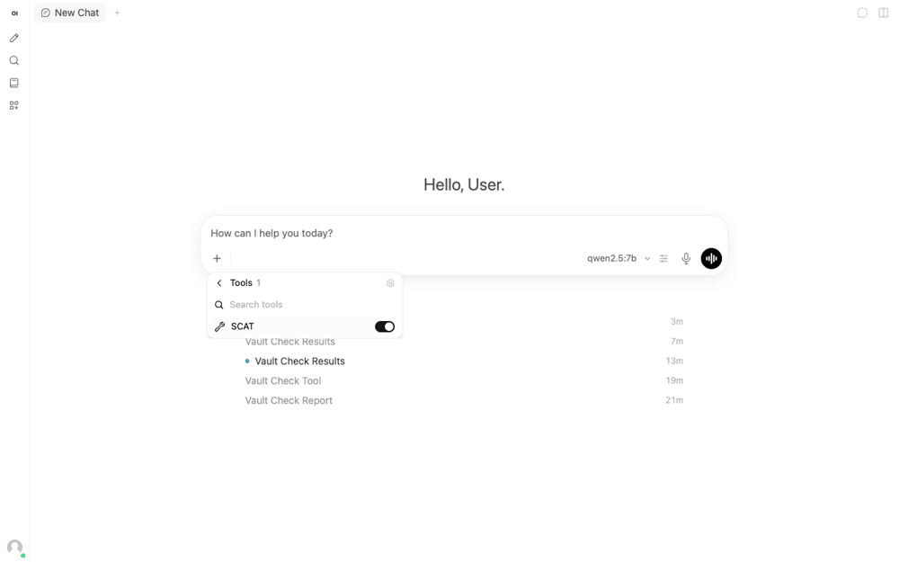
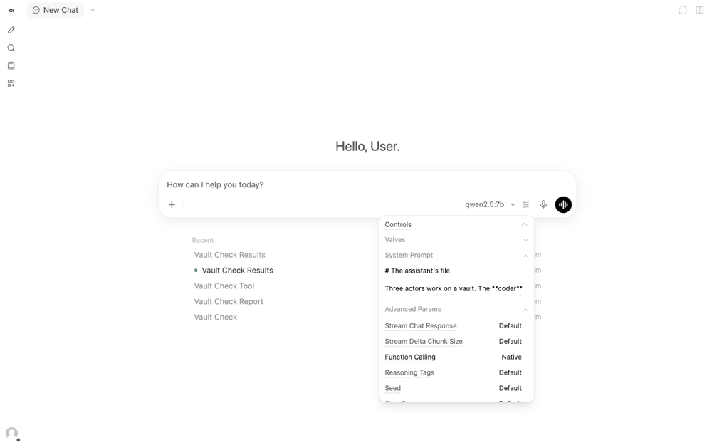
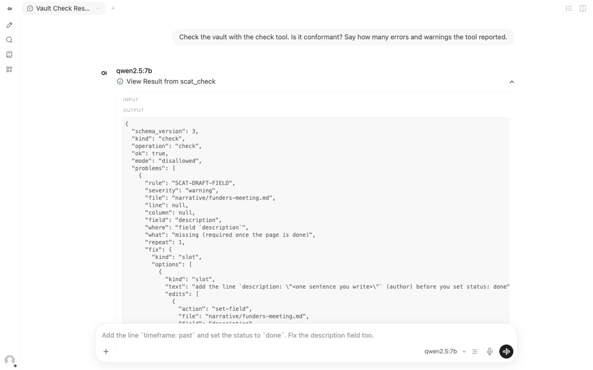
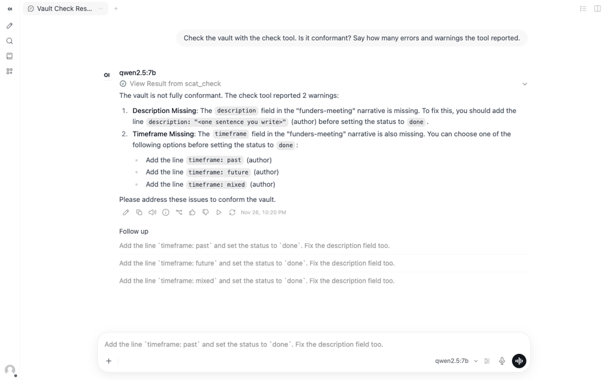

# A local LLM

!!! tip "Your next step"
    Read "What this path needs", then follow the worked example to see one complete setup.

Code with a language model that runs on your own computer, which you supply, so your notes and your chat go to a model on your own computer. You code as on
the [chat path](chat-path.md): the assistant drafts and proposes, you decide, and the tool checks. This page says what
the SCAT side needs from any local setup, then shows one setup, Ollama and Open WebUI in Docker, from start to stop.
Another model runner or another chat client that meets the same needs works the same way.

## What this path needs

- **A model that can call tools.** The SCAT server offers its operations as tools, and the model has to ask for them
  by name. Ollama marks such models as "tools" in its library. A small model often answers from its own guesses
  instead of calling the tool.
- **A client that speaks MCP.** The client connects to the SCAT MCP server over streamable HTTP and sends the key as
  `Authorization: Bearer <key>`. Open WebUI is one such client.
- **The SCAT server, reachable from the client.** The server is the `scat-mcp` command, from the `scat-kg-tools`
  repository ([MCP server reference](reference/mcp.md)). It serves one vault folder, which you mount into its
  container. The client reaches it by address and port: here, by the server's name on a Docker network.
- **The key.** The server answers 401 to a request without its key. Make a new key for each session and keep it in
  your terminal, not in a file.
- **The assistant's rules.** `contracts/assistant.md` in the repository is the assistant's file. Give it to the model
  as its system prompt. The server also offers the same text as the resource `scat://assistant-rules` and as prompts.

Whatever the setup, the tool decides whether the vault conforms, and the model does not. Run `scat check` in
your vault yourself and read its last line. You own the interpretation; the model only helps. The server cannot set a
narrative to `done`, so the model cannot either: you do that in Obsidian.

### What hardware to expect

- **Memory.** A model stays in memory while you use it: about 5 GB for a 3B model and about 6.5 GB for a 7B model.
  Open WebUI and the server add about 1 GB. Give Docker enough memory for all of it: at least 8 GB for a 7B model
  (Docker Desktop: Settings > Resources; Colima: `colima start --memory 12`).
- **Context.** The rules and the tool list together run to several thousand tokens. Ollama's default context window
  cuts them off, and the model then does not see the tool. The example sets 8192.
- **Time.** A turn can take minutes on an older Mac. The first turn also loads the model; later turns come faster.
- **No GPU in Docker on a Mac.** A model in a Docker container on a Mac runs on the processor only.

## Worked example: Ollama in Docker with Open WebUI

Ollama runs the model, Open WebUI is the chat window, and the SCAT server serves your vault. All three run in Docker,
on one Docker network, started by one file and a few terminal commands. The model is `qwen2.5:7b`; any model that can
call tools takes its place. You need Docker running (Docker Desktop or Colima), a clone of `scat-kg-tools` in your home
folder (the server is built from it: `git clone https://github.com/DynamicalSystemsGroup/scat-kg-tools ~/scat-kg-tools`),
and a vault in a folder in your home folder outside Documents, Desktop, Downloads and iCloud (macOS hides those from a
container). The steps call the vault folder `~/my-vault` and keep the setup in `~/local-llm`. Use one terminal window
for the steps that start with `export`: the variables and the key live only in it. Downloads at the first start: the
images (several GB; Open WebUI's is the largest), the model from Ollama's library, and a small helper model that Open
WebUI fetches for itself from huggingface.co. Your chat text goes only to the model in your Ollama container.

1. **In a terminal:** make the folder `~/local-llm`, go into it, and write the setup file. The file starts three
   containers: Ollama (with the context window set), the SCAT server (read-only, running as you, with your vault
   mounted) and Open WebUI.

    ```text
    mkdir -p ~/local-llm && cd ~/local-llm
    cat > compose.yaml <<'EOF'
    services:
      ollama:
        image: ollama/ollama
        environment:
          OLLAMA_CONTEXT_LENGTH: "8192"
        volumes:
          - ollama:/root/.ollama
      scat-mcp:
        build:
          context: ${SCAT_SRC}
          dockerfile: deploy/Dockerfile
        user: "${UID_GID}"
        read_only: true
        tmpfs: /tmp
        environment:
          SCAT_MCP_KEY: ${SCAT_MCP_KEY}
        volumes:
          - ${VAULT}:/vault
      open-webui:
        image: ghcr.io/open-webui/open-webui:main
        ports:
          - "127.0.0.1:3000:8080"
        environment:
          WEBUI_AUTH: "False"
          OLLAMA_BASE_URL: http://ollama:11434
        volumes:
          - open-webui:/app/backend/data
        depends_on:
          - ollama
    volumes:
      ollama:
      open-webui:
    EOF
    ```

    You should see the file `compose.yaml` when you run `ls`. Open WebUI is published on `127.0.0.1` only, so only this
    Mac reaches it, and `WEBUI_AUTH: "False"` switches its sign-in off for that single local user: no account or
    password is created. The SCAT server is not published at all; only Open WebUI reaches it, over the Docker network.

2. **In a terminal:** name your clone, your vault and a new key, then start everything. The first start downloads
   the images and builds the server: it took about 40 minutes on a slow connection, and later starts take seconds.

    ```text
    export SCAT_SRC=~/scat-kg-tools
    export VAULT=~/my-vault
    export SCAT_MCP_KEY=$(openssl rand -hex 16)
    export UID_GID="$(id -u):$(id -g)"
    docker compose up -d --build
    ```

    You should see three containers started. `docker compose ps` lists them as running. Keep this terminal open
    for the rest of the session.

3. **In a terminal:** pull the model into Ollama's volume (4.7 GB; a few minutes on a fast connection).

    ```text
    docker compose exec ollama ollama pull qwen2.5:7b
    ```

    You should see `success` at the end.

4. **In a web browser:** open <http://localhost:3000>. Open WebUI downloads a small helper model on its first start, so
   the page can take a minute or two to answer. You should see Open WebUI's start page, with no sign-in, and your
   model's name at the right of the message box.

    

5. **In Open WebUI:** register the SCAT server. Open the address
   <http://localhost:3000/admin/settings/integrations>, and next to **External Tool Servers** choose **+**. Click the
   type at the top right of the form until it reads **MCP Streamable HTTP**. Fill in:

    | Field | Value |
    | --- | --- |
    | Name | `SCAT` |
    | URL | `http://scat-mcp:8765/mcp` |
    | Auth | **Bearer**, then the key (print it in your terminal with `echo $SCAT_MCP_KEY`) |
    | Function Name Filter List | `check, status` |

    Choose **Save**. You should see "Connections saved successfully" and a row **SCAT** under External Tool Servers.
    The URL uses the server's name on the Docker network, because inside Open WebUI's container `localhost` is Open
    WebUI itself. The filter list offers the model two tools instead of all nineteen, which keeps each request short. It uses the
    server's tool names, `check` and `status`; Open WebUI shows a tool as the connection's ID plus its name, so `check`
    appears as `scat_check`.

    

6. **In a terminal:** copy the assistant's file to the clipboard.

    ```text
    pbcopy < $SCAT_SRC/contracts/assistant.md
    ```

    Nothing prints; the clipboard now holds the rules.

7. **In Open WebUI:** go back to the start page (**New Chat**) and choose the model `qwen2.5:7b` at the right of the
   message box. Choose the **+** at the left of the message box, then **Tools**, and switch **SCAT** on. You should
   see the switch dark.

    

8. **In Open WebUI:** choose the sliders button at the right of the model name to open Chat Controls. Paste the rules
   into **System Prompt**. Under **Advanced Params**, click **Function Calling** once so it reads **Native**. You
   should see the rules' first line, `# The assistant's file`, in the System Prompt box and **Native** at Function
   Calling. Native passes the tools to the model as tool calls.

    

9. **In Open WebUI:** ask the model to check the vault, and wait for the answer (several minutes on an older Mac):

    ```text
    Check the vault with the check tool. Is it conformant? Say how many errors and warnings the tool reported.
    ```

    You should see a line **View Result from scat_check** above the answer. Click it to open the tool's own result.

    

    

10. **In a terminal:** run the check yourself, in your vault, and compare it with what the model said.

    ```text
    cd ~/my-vault
    uv run --project ~/scat-kg-tools scat check
    ```

    You should see the same two warnings and the last line `0 errors, 2 warnings`. Compare: do the warnings the model listed
    match the tool's two, and do its words ("not fully conformant" in the example) match the tool's line? The tool's line
    says no errors; the two warnings are fields to fill in before the narrative is done. The tool's output settles it.

11. **In a terminal:** stop the session. 

    ```text
    cd ~/local-llm
    docker compose down
    ```

    You should see the three containers removed. The downloaded model and Open WebUI's data stay in their volumes for
    the next session. Each session has a new key: start again with step 2, then in Open WebUI open Settings >
    Integrations, choose the gear on the **SCAT** row, paste the new key (`echo $SCAT_MCP_KEY`) and choose **Save**.
    Open WebUI keeps the old key until you do, and the server answers it with 401. To remove the volumes too, run
    `docker compose down --volumes`.
