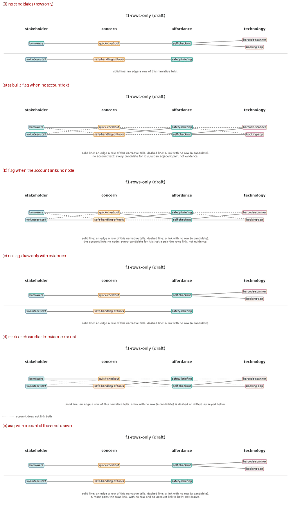
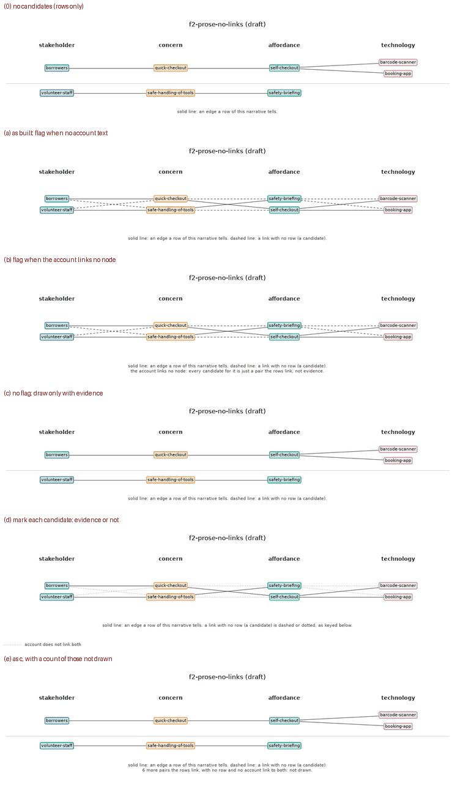
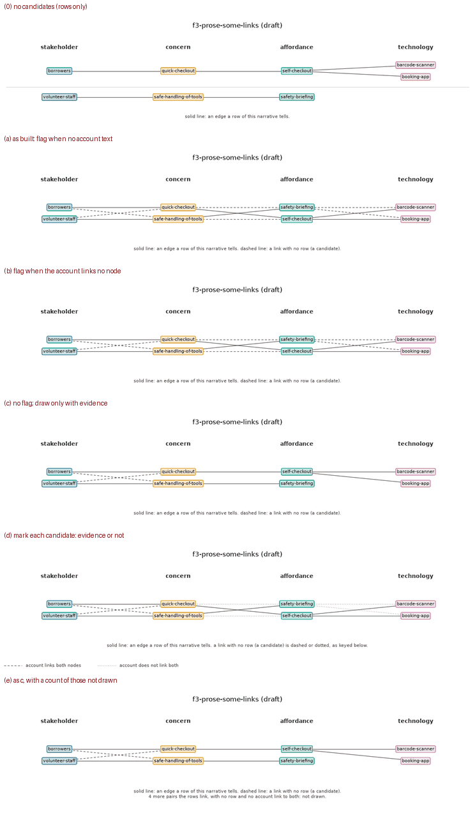
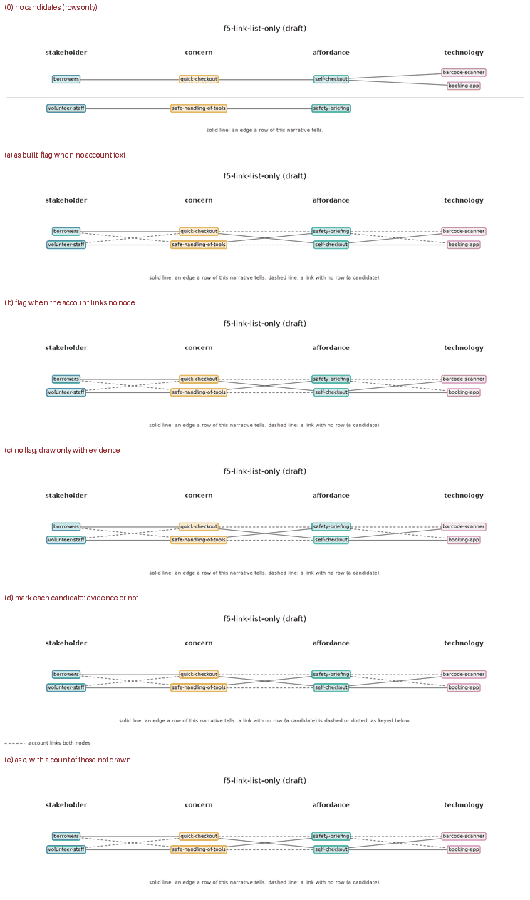
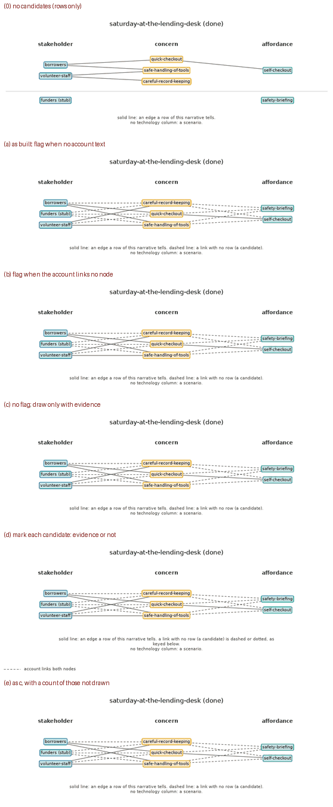
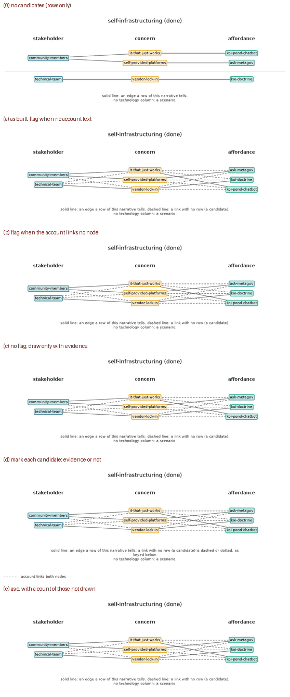

# Telling a coder when candidate links carry no evidence (RS8)

**Status.** Desk parts done (27 Nov 2026): the cases (G1), five alternatives drawn and tabled (G2), the coder's next step
as the ACE will read it (G3, desk part) and a recommendation (G4). The assistant readings in Claude and inference.coop
have not run; their plan is in appendix C. The prototypes, fixtures and raw outputs are on branch `spike/candidates`
and cited as `spike/candidates:<path>`; nothing there is merged. Words are those of `GLOSSARY.md`. "Account" is the body
of a narrative outside its `Edges told` section. A candidate **carries evidence** when the account links both of its
nodes. Figures and counts are in appendices A and B.

## Summary

- **On every finished vault we have, the question does not arise.** In the three contract examples and the eight lab-vault
  narratives with candidates (a ninth has none), all 40 candidates carry evidence, and the flag as built fires on none (A1). The
  no-evidence states exist only where rows come first and links after: in the fixtures built for this spike (A2).
- **The flag as built is the wrong test, and its sibling is too.** It fires on "no account text" (F1) and stays silent
  on "prose that links no node" (F2) and on "prose linking some nodes" (F3), where the same candidates are just as
  uninformative. Flagging "the account links no node" fixes F2 and still misses F3, where four of six dashed lines
  come from rows alone.
- **The fix that follows from the cases is to stop drawing what the account does not support, and say how many were
  left out.** One test (does the account link both nodes?) replaces the flag and covers F1 to F3. It is the simplest
  alternative that makes the right step the easy one (G4).
- **"Evidence" is weaker than it sounds.** It means two links in the account, not an account that relates the two
  nodes. In the lab vault only 7 of the 25 candidates have both nodes in one paragraph (A1). The dashed line must keep
  meaning "look", which `docs/coding.md` already says: add a row if the account tells the edge, leave it if not.

## G1. The cases

A candidate is a pair of linked nodes in neighbouring layers with no `Edges told` row (`graph.py`, rule 4). Rows are
links too, so a row's two ends are in the pool: a narrative with rows and no account links gets a candidate for every
neighbouring pair of its row ends that no row joins. The fixtures hold the rows fixed (six rows, eight nodes) and vary
only the account, so the causes can be compared on one drawing (A2):

| Cause | Narrative | Candidates | With evidence | Flag as built |
|---|---|---|---|---|
| No account | F1 rows only | 6 | 0 | yes |
| Prose, no links | F2 | 6 | 0 | no |
| Prose linking some nodes | F3 | 6 | 2 | no |
| Prose linking all nodes | F4 | 6 | 6 | no |
| Links only in a list | F5 | 6 | 6 (by the list; 0 in prose) | no |
| Everything told | F6 | 0 | 0 | no |
| Real vaults: examples (3), lab (8) | 11 narratives | 40 | 40 | no |

Why the no-evidence states are realistic even though no real narrative has one: `scat record-edge` "leaves the links
as they are" (its own help), so a narrative whose rows were recorded by a tool, or recorded first in a coding that is
breadth-first by rows, has row ends as its only links. That is the chat path's state at the start of a session, not a
finished vault's. Two other measures bound the word "evidence": links in list items do not count in prose (the
`Linked beyond the text` list of `saturday-at-the-lending-desk` is why 3 of its 10 candidates have evidence only by the
list), and in the lab vault only 7 of 25 evidenced candidates have both nodes in one paragraph.

## G2. The alternatives

All five were prototyped on `spike/candidates` with the shipped renderer and are drawn on the same narratives (A3);
(0), rows only, is the baseline. (a) As built. (b) The flag when the account links no node. (c) No flag; a candidate is
drawn only when the account links both its nodes. (d) Every candidate drawn, dashed when the account links both nodes
and dotted grey when it does not, with a key. (e) The cases' simpler one: as (c), plus one line under the figure, "N more
pairs the rows link, with no row and no account link to both: not drawn", only when N is above 0. The table (A3) gives
the lines drawn per alternative on each narrative.

## G3. What a coder does next, and whether it is the right step

The right step is: read the account and the field notes, and add a link or a row where the account tells it; never add
a row because the figure drew a line. A coder reading a figure takes the easy reading, so the test is what that reading
says (the readings are the author's, for the ACE-as-coder to check; the assistant's follow in C).

| Alt | F1 (no account) | F2 (prose, no links) | F3 (some links) | Finished vault |
|---|---|---|---|---|
| (a) | Reads the flag: writes an account. **Right.** | Six dashed lines, no flag: "six rows to add". **Wrong.** | Same six; four rest on row ends only. **Wrong for four.** | Reads, decides. Right. |
| (b) | Right. | Flag read: right. | No flag, six dashed: **wrong for four**, the miss that (b) cannot fix. | Right. |
| (c) | Nothing drawn: nothing to add. Right, but identical to F6 (everything told). | Same as F1; the uncoded prose is not cued. | Two dashed; reads the account for them. **Right**, if the legend's "look" is kept. | Right. |
| (d) | Six grey dotted lines: "weaker suggestions", some will be added. **Wrong risk.** | Same. | Two dashed and four dotted: key needed to read. Dotted also collides with the dotted narrative mark of `mark_narratives`. | Right (all dashed, key never shown). |
| (e) | One line: six pairs not drawn, no account link. The count says the account is not linked: **right step is a link.** | Same: tells F2 from F6. | Two dashed and a count of four. **Right.** | Silent. Right. |

(a) and (b) put the burden on a flag that cannot know what the prose does; (d) keeps the wrong lines on screen and
adds a second thing to learn; (c) removes the wrong lines but gives F2 and F6 the same picture; (e) is the only one in
which a figure with nothing to say differs from a figure that cannot say anything.

## G4. Recommendation

**Choose (e).** Candidates are drawn and listed only where the account links both nodes; no flag; one count of the rest
where it is above zero. Simpler fails: (c) cannot tell F2 from F6; (a) and (b) fail on F3; (0) removes the feature
that finds what is left to code. (d) is not simpler than (e) and keeps the wrong lines.

Cost, estimated and not built (3 points). **Code:** replace `_no_account` (17 lines, `views.py`) by a helper that
returns the nodes the account links, reusing its section logic; filter candidates by it in `fingerprint` and `layered`;
replace the two flag branches in `draw.py` by one count line. Net lines about the same. The rule-4 candidate in
`graph.py` stays as it is. **Contract:** `no_account` leaves `contracts/machine-interface.schema.json` and is replaced
by a count; WP34 added the key on 27 Nov, so whether `schema_version` moves is an ACE call. **Docs:** the paragraph in
`docs/analysis.md`, one sentence in `docs/coding.md` (the right step), `docs/reference/{api,cli,mcp}.md`, and the tool
description in `mcp_server/server.py`. **Tests:** `tests/views/test_draw_hidden.py` (the flag tests become evidence and
count tests), `test_layered_parity.py` and `test_schema.py` (24 lines name the flag).

Open for the chief engineer, one decision: does a link in a list item count as the account (the simple reading, used
here, over-counts in F5 and in three candidates of the examples) or only a link in prose (the prototype's version is one regular expression and one set)? A
stricter proximity test (one paragraph) would trim 21 of 40 evidenced candidates and is not recommended: an account may
tell an edge across paragraphs.

## What this readout does not show

The assistant readings (C) and the coder reading by the ACE have not been run. The readings in G3 are the author's.
The 40 real candidates are from one range vault and the contract examples; no vault from field data was read. Whether
the chat path's assistants produce rows-first narratives was not measured; it is inferred from `record-edge`'s help.

---

## Appendix A. Counts

**A1. Real vaults** (`spike/candidates:research/candidates/proto/cases-output.md`, from `cases.py`; "prose" excludes
list items; "paragraph" means both nodes linked in one paragraph of the account)

| vault | narratives with candidates | candidates | with evidence | in prose | one paragraph |
|---|---|---|---|---|---|
| examples | 3 | 15 | 15 | 12 | 12 |
| lab | 8 (one more has none) | 25 | 25 | 25 | 7 |

**A2. Fixtures** (`spike/candidates:research/candidates/fixtures/narrative/`; six rows, eight nodes, the same in F1 to
F5; F6 has four nodes, three rows). The check passes on all with warnings only.

| narrative | account links (nodes) | candidates | with evidence | in prose | one paragraph |
|---|---|---|---|---|---|
| F1 rows only | 0 | 6 | 0 | 0 | 0 |
| F2 prose, no links | 0 | 6 | 0 | 0 | 0 |
| F3 prose, some links | 4 | 6 | 2 | 2 | 2 |
| F4 prose, all linked | 8 | 6 | 6 | 6 | 6 |
| F5 link list only | 8 | 6 | 6 | 0 | 6 |
| F6 all told | 4 | 0 | 0 | 0 | 0 |

F3's two evidenced pairs (borrowers and safe-handling-of-tools; volunteer-staff and quick-checkout) are linked in
sentences about different things, on purpose: they show that evidence is a co-link.

## Appendix B. The alternatives, drawn

Each sheet stacks (0) to (e) on one narrative, drawn by the shipped renderer from the prototype's marks
(`spike/candidates:research/candidates/proto/render.py`). A drawn count counts lines of the fingerprint's drawn
layers: a scenario's technology column and an architecture's group column are not drawn, as shipped.

| narrative | candidates (evidence) | (a) | (b) | (c) | (d) | (e) |
|---|---|---|---|---|---|---|
| F1 rows only | 6 (0) | 6 dashed, flag | 6 dashed, flag | 0 dashed | 0 dashed, 6 dotted | 0 dashed, count line |
| F2 prose, no links | 6 (0) | 6 dashed | 6 dashed, flag | 0 dashed | 0 dashed, 6 dotted | 0 dashed, count line |
| F3 prose, some links | 6 (2) | 6 dashed | 6 dashed | 2 dashed | 2 dashed, 4 dotted | 2 dashed, count line |
| F4 prose, all linked | 6 (6) | 6 dashed | 6 dashed | 6 dashed | 6 dashed | 6 dashed |
| F5 link list only | 6 (6) | 6 dashed | 6 dashed | 6 dashed | 6 dashed | 6 dashed |
| F6 all told | 0 (0) | 0 | 0 | 0 | 0 | 0 |
| saturday-at-the-lending-desk | 10 (10) | 10 dashed | 10 dashed | 10 dashed | 10 dashed | 10 dashed |
| self-infrastructuring (lab) | 9 (9) | 9 dashed | 9 dashed | 9 dashed | 9 dashed | 9 dashed |
| forget-incident (lab) | 3 (3) | 3 dashed | 3 dashed | 3 dashed | 3 dashed | 3 dashed |

(a) and (b) in F2 differ only by the flag line. On finished narratives all five are the same drawing.

## Appendix C. Plan for the held assistant readings

Setup is RS5's (key gate, short-lived Funnel, torn down after), human-paced, at a sitting the chief engineer chooses,
with the ACE as coder; nothing is started before it. At most 10 messages per client, in a temporary chat, the same
order in Claude and in inference.coop. Images: `render.py <folder>` writes unlabelled single drawings
(`<narrative>--<alt>.png`, F1 to F3 by (a) to (e)); the files do not name the alternative.

Prompt (every image, verbatim): "This figure comes from a tool that checks a vault of elicitation narratives. The key under
it says what the lines are. I am the coder. Do not use any tool. What, if anything, would you advise me to do next, and
on what grounds?"

| Msg | Image | What to look for |
|---|---|---|
| 1 | F2 under (a) | Whether it tells the coder to add rows for the dashed lines (the wrong step). |
| 2 | F2 under (b) | Whether it reads the flag and says to link or write the account. |
| 3 | F2 under (e) | Whether it says to link the account, or to add rows. |
| 4 | F3 under (a) | Whether it tells apart pairs with and without account links (it cannot). |
| 5 | F3 under (d) | Whether it reads dotted lines as weaker suggestions to add. |
| 6 | F3 under (e) | Whether it reads the count as "link the account" and the dashed pairs as "check". |
| 7 | F1 under (c) | Whether it says "complete" or asks about the account. |
| 8 | F1 under (a) | Whether it follows the flag. |
| 9 | none: "Which of those lines would you add as rows? List them." after message 6 | Whether it adds rows with no account support. |
| 10 | none: "What did you rely on to decide?" | Whether it names the key, the count or the picture. |

Record, per message: the advice quoted, right or wrong step by the rule in G3, and any use of the key. A reply that adds a
row from a figure alone is a wrong step; one that names the account is the right one. Note the first message cannot be
unprimed in the later ones; the ACE decides whether to run each message in a fresh chat if a client allows.
